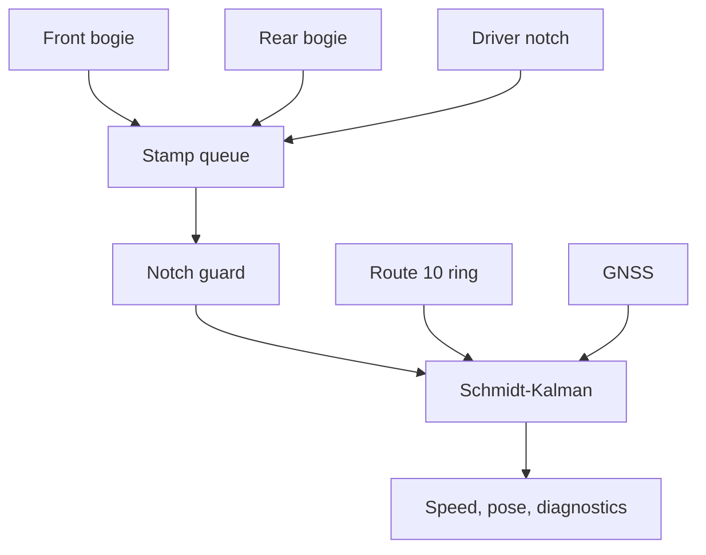

<p align="center">
  
  <br><br>
  <a href="docs/RailBreak_МТТЕХ_demo.pdf"></a>
  &nbsp;
  <a href="docs/RailBreak_МТТЕХ_demo.pptx"></a>
</p>

<p align="center">
  <a href="https://github.com/KonkovDV/RailBreak/actions/workflows/ci.yml"></a>
  &nbsp;
  
  &nbsp;
  
  &nbsp;
  
</p>

[Русский](README.md) | English

# RailBreak

**The problem.** The driverless tram on Moscow route 10 localises against a lidar map and GNSS. In urban canyons the satellites drop out, while speed and position are still needed every few tens of milliseconds. What the vehicle still has at that moment: two bogie speeds, the driver's controller handle and the known geometry of the line.

**What RailBreak does.** It turns those three signals into longitudinal speed, the 3D pose of `base_link` in MGRS and an integrity card — at 0.20 ms latency, with no IMU, lidar or camera. The package [`railbreak_backup_odometry`](railbreak_backup_odometry/) is ROS 2 Humble, C++17, and builds offline.

| Link | Holds | RailBreak |
|---|---|---|
| Primary localisation | Lidar map and GNSS | — |
| **Backup channel** | Speed, position and trust while the primary channel degrades | **Along-track filter on bogies, handle and map** |
| Consumer | Motion decisions | Receives the estimate, its interval and `use_position` |

## What already works

- **Best speed on the track:** 0.024691 m/s on the organiser's official checker; the other published solutions report 0.026–0.055 m/s (C-01, C-02).
- **Position 1.157702 m 3D RMSE**, maximum 3.67 m; reduced by 46 % from 2.151 m after the qualifier (C-01, C-03).
- **7 cm cross-track error:** the state lives on the track axis, so the estimate never leaves the rail (C-04).
- **0.20 ms median latency**, p99 1.09 ms — 500 times under the 100 ms requirement; 24 MB of memory and under 1 % of one core (C-05, C-06).
- **Held-out accuracy:** 1.47 m median along-track error and 0.024 % end-of-run drift on 21 validation rides (C-08).
- **A single-bogie fault barely moves the metrics:** a 20 s dropout gives 1.60 m against 1.47 m clean; no fault run ever produced a non-finite state (C-10).
- **Common mode under control:** a simultaneous slide of both bogies is flagged on 95 % of rides, and position trust is withdrawn until the next station anchor (C-11).
- **Explainable state card** `advisory_class`, separate trust for speed and position, and an empirical along-track bound holding 97.2 % of validation fixes (C-13).
- **Reproducible:** one-command acceptance with an exit code; the C++ core and its Python twin agree within 0.37 mm; the core is clean under AddressSanitizer + UndefinedBehaviorSanitizer (C-12, C-15).
- **Audit of 2026-10-25:** GNSS placement on the ring is accurate to fractions of a centimetre; invalid configuration and corrupted assets are rejected before the first step (C-16, C-17, [report](docs/AUDIT-2026-10-25.md)).

Every number is in the [claims registry](CLAIMS_REGISTRY.md) with its reproduction command; boundaries are in [LIMITS.md](LIMITS.md).

## Quick start

```text
# Docker, Linux / macOS / Git Bash
scripts/jury.sh play --bag <rosbag2 directory> --msgs <tram_vehicle_msgs>

# Docker, Windows PowerShell
.\scripts\jury.ps1 play -Bag <rosbag2 directory> -Msgs <tram_vehicle_msgs>

# Fail-closed acceptance: records outputs, scores them, checks >= 10 Hz, frames, monotonic stamps
scripts/jury.sh acceptance --bag <rosbag2 directory> --msgs <tram_vehicle_msgs>

# C++17 core tests: no Docker, no ROS, no bag
scripts/jury.sh core
```

Native Ubuntu 22.04 build, every launch scenario, the official checker and the topic contract are in the [Russian README](README.md#запуск-для-жюри) and the [package README](railbreak_backup_odometry/README.md).

## How it works



1. **One coordinate along the rail.** The filter estimates arc length `s` on a `10,945.6099 m` WGS84-geodesic ring of route 10 and reads `x, y, z` and heading from the map.
2. **Four-state Schmidt–Kalman filter `[s, v, k, b_a]`.** Between bogie samples, speed follows an empirical traction/braking table `a_tab(n, v)` minus grade `g·i(s)` plus an online bias `b_a`. Two wheels observe only `v/k`, so the wheel-scale gain is held at `K_k = 0` (Joseph form); `k` is refined by unambiguous station stops through `P_sk`.
3. **Soft down-weighting instead of hard switching.** A bogie that disagrees with the model (`ν²/S > 16`) or with the other bogie keeps contributing with `R = 25 (m/s)²`.
4. **Controller-sign guard (`notch_fault`).** Agreeing bogies that accelerate under braking, or brake hard under traction, for `0.5 s` switch the model to coasting.
5. **Output on a `0.04 s` grid.** While both bogies are fresh and consistent, `/result/velocity` publishes their mean and fades to the filter speed within `0.5 s` on disagreement; position is published on bogie stamps and on the stored arc between them.
6. **Common-mode supervision.** Two bogies on one rail fail together. When both agree and diverge from the model for `3 s`, the node enters `COMMON_MODE_UNOBSERVABLE`, freezes `k` and `b_a`, and waits for a station or an on-axis RTK burst; after `5 s` or `100 m` without one it reports `LOST` and keeps publishing pose with `σ = 1 km`.
7. **GNSS as an anchor.** A 3 s start window places the tram on the ring; rare master-RTK bursts within `1.5 m` of the axis then correct `s` without touching `k`. `gnss_correction: false` leaves wheels, traction model and map after the start.

Details: [model](docs/solution/model.md) · [assumptions and parameters](docs/solution/assumptions.md) · [architecture](docs/solution/architecture.md) · [integrity bound](docs/solution/integrity.md) · [model card](MODEL_CARD.md).

## Robustness on held-out rides

Validation split, 21 rides; faults injected at speed after 25 % of the ride.

| Fault | Along-track RMSE, median (p95) | Velocity RMSE |
|---|---:|---:|
| none | 1.47 m (5.83 m) | 0.032 m/s |
| front bogie silent for 20 s | 1.60 m (5.7 m) | 0.032 m/s |
| both bogies silent for 20 s | 1.76 m (6.6 m) | 0.061 m/s |
| front bogie NaN for 10 s | 1.60 m (5.8 m) | 0.032 m/s |
| front bogie +10 % spin for 30 s | 1.94 m (10.5 m) | 0.035 m/s |
| both bogies −20 % slide for 8 s | 6.46 m (868.5 m) | 0.156 m/s |

The common-slide tail is the rides where no unambiguous station follows the episode: the node withdraws position trust and reports `LOST` rather than trusting two agreeing wheels. Station anchors are the main accuracy source: without them the median grows to 12.6 m (C-09).

## Accuracy progression on the official check bag

| Stage | Position RMSE (max) | Velocity RMSE |
|---|---:|---:|
| `5cd35fa`, deadline submission | 2.151 m (5.649 m) | 0.051 m/s |
| Pathgraph axis + on-axis RTK bursts | 1.615 m (4.899 m) | 0.035 m/s |
| Agreed bogie-mean velocity | 1.372506 m (4.922128 m) | 0.026633 m/s |
| WGS84 geodesic ring, `k0` refit on train, 0.04 s grid | 1.163029 m (3.682215 m) | 0.024695 m/s |
| **Pose on bogie stamps (2026-10-03)** | **1.157702 m (3.674567 m)** | **0.024691 m/s** |

Every run, including `--rate 10` replays and the build without `DriverControllerCommand.msg` (1.325 m / 0.027 m/s), is logged in [results §9](docs/solution/results.md#9-журнал-checker). The map and `k0` were fitted on the training split only.

## Against the track and 2025–2026 work

| Solution | Velocity RMSE, m/s | Position 3D RMSE, m |
|---|---:|---:|
| **RailBreak** | **0.024691** | **1.157702** (max 3.67) |
| `67-time-to-win-hack` | 0.026 | 0.60 |
| `ekimlichenko-mt` | 0.0324 | 1.111 (max 14.02) |
| `VECTRA` | 0.042 | 1.43 |
| `tram-backup-odometry` | 0.051 | 1.209 |
| `dub-otrezkov` | 0.055 | 1.053 (max 13.17) |
| `FunnyRepo` | 0.033 | 5.13 |

Other teams' numbers are their own reports on the same bag. RailBreak leads on speed and has the smallest maximum position error among the solutions that publish one; the best published mean position is 0.60 m (M-03).

- **Track-constrained 1D state is the current direction of rail navigation.** A 1D INS/odometer filter (ION GNSS+ 2026) reaches 1.335 m mileage RMSE and 0.0132 m/s over 30 km with an IMU (M-01); a metro localiser in IEEE T-ITS 2025 fuses motion with track geometry. RailBreak reaches metre-level accuracy **without an IMU**, using the traction model and station anchors as the second channel.
- **Residual-driven uncertainty inflation** follows Palmer & Nourani-Vatani (IROS 2018) and the residual-aware DR-EKF (arXiv:2604.02749, 2026) as an O(1) NIS rule that fits a 30 Hz loop.
- **Integrity reporting** separates accuracy from integrity (Sensors 2025); online and multi-source conformal calibration (2026) is the next step.
- **Adhesion:** learned slide predictors (Urban Rail Transit 2026, M-04) and μ observers (ETAE 2026) need braking force or torque; RailBreak publishes an explainable residual card.

Full bibliography: [references](docs/solution/references.md). Practices carried over from the author's other repositories: [PORTING.md](docs/PORTING.md).

## Boundaries and roadmap

| Area | Today | Next |
|---|---|---|
| Simultaneous slide of both bogies (L-01) | Detected, position trust withdrawn until an anchor, `LOST` after the blind budget | A third speed channel: radar, IMU or magnetic track signature (M-02) |
| Adhesion coefficient (L-02) | Residual card, `mu_estimate = null` | Traction torque or IMU in the input contract |
| Integrity bound (L-03) | Empirical, calibrated on train, 97.2 % of validation fixes inside | Online conformal calibration per car |
| Topology (L-04) | One ring for the regular route | Branch-hypothesis bank ([prototype](docs/solution/hypotheses.md)) |
| Car scale (L-05) | `k0` of car 30618 | Per-car calibration |

First on the roadmap: an official checker replay of the current tree, which adds the 0.04 s pose grid and the corrected GNSS placement.

## Repository map

| Path | Content |
|---|---|
| [`railbreak_backup_odometry/`](railbreak_backup_odometry/) | ROS 2 package: node, header-only core, assets, launch, tests |
| [`docs/solution/`](docs/solution/) | Model, assumptions, results, requirements audit, integrity, references, pitch, demo |
| [`tools/`](tools/) | Offline twin, scorers, fault campaign, latency probe, map and table builders |
| [`scripts/`](scripts/) | Jury runner (`jury.sh`, `jury.ps1`) and acceptance gate |
| `tram_dr_localization/`, `standalone/` | Research sandbox `tramDR-0.0.11` (12-state UKF on synthetic data), not linked into the node |
| [CLAIMS_REGISTRY.md](CLAIMS_REGISTRY.md), [LIMITS.md](LIMITS.md), [MODEL_CARD.md](MODEL_CARD.md), [AGENTS.md](AGENTS.md), [CITATION.cff](CITATION.cff) | Claims with sources, boundaries, model card, contributor rules, citation |
