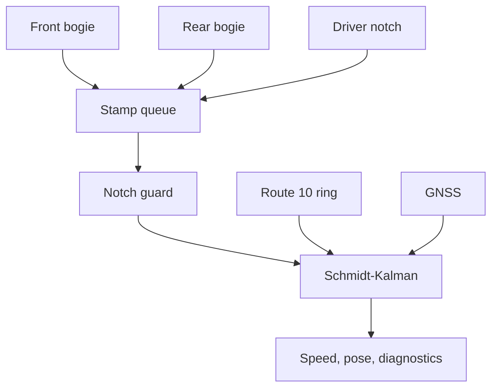

<p align="center">
  
  <br><br>
  <a href="docs/RailBreak_МТТЕХ_demo.pdf"></a>
  &nbsp;
  <a href="docs/RailBreak_МТТЕХ_demo.pptx"></a>
</p>

<p align="center">
  <a href="https://github.com/KonkovDV/RailBreak/actions/workflows/ci.yml"></a>
  &nbsp;
  
  &nbsp;
  
  &nbsp;
  
</p>

Русский | [English](README.en.md)

# RailBreak

**Проблема.** Беспилотный трамвай маршрута № 10 в Москве держит положение по лидарной карте и GNSS. В городском каньоне спутники пропадают, а скорость и положение нужны каждые десятки миллисекунд. У вагона в этот момент остаются две скорости тележек, ручка контроллера и известная геометрия пути.

**Что делает RailBreak.** Превращает эти три сигнала в продольную скорость, 3D-положение точки `base_link` в MGRS и карточку достоверности — с задержкой 0.20 мс, без IMU, лидара и камер. Пакет [`railbreak_backup_odometry`](railbreak_backup_odometry/) — ROS 2 Humble, C++17, собирается без сети.

| Звено | Что держит | RailBreak |
|---|---|---|
| Основная локализация | Лидарная карта и GNSS | — |
| **Резервный канал** | Скорость, положение и доверие, когда основной канал деградирует | **Фильтр вдоль пути на тележках, ручке и карте** |
| Потребитель | Решение о движении | Получает оценку, её интервал и статус `use_position` |

## Что уже работает

- **Лучшая скорость трека:** 0.024691 м/с на официальном checker организатора; у остальных опубликованных решений — 0.026–0.055 м/с (C-01, C-02).
- **Положение 1.157702 м по 3D RMSE** с максимумом 3.67 м; после отбора ошибка снижена с 2.151 м на 46 % (C-01, C-03).
- **Поперечная ошибка 7 см:** состояние живёт на оси пути, и оценка не сходит с рельса (C-04).
- **Задержка 0.20 мс** по медиане, p99 1.09 мс — в 500 раз ниже порога ТЗ в 100 мс; 24 МБ памяти и меньше 1 % одного ядра (C-05, C-06).
- **Точность на отложенных рейсах:** медиана 1.47 м вдоль пути и дрейф 0.024 % пройденного на 21 рейсе `val` (C-08).
- **Отказ одной тележки почти не виден в метриках:** пропуск 20 с — 1.60 м против 1.47 м без сбоя; ни один прогон сбоев не дал NaN или Inf (C-10).
- **Общая мода под контролем:** синхронный юз обеих тележек ловится в 95 % рейсов, доверие к положению снимается до якоря станции (C-11).
- **Объяснимая карточка состояния** `advisory_class`, раздельное доверие к скорости и положению, эмпирическая граница вдоль пути — 97.2 % фиксов `val` внутри (C-13).
- **Воспроизводимо:** приёмка одной командой с кодом возврата; C++-ядро и Python-двойник совпадают до 0.37 мм; ядро чисто под AddressSanitizer + UndefinedBehaviorSanitizer (C-12, C-15).
- **Аудит 2026-10-25:** привязка GNSS к кольцу точна до долей сантиметра, некорректная конфигурация и повреждённые assets отклоняются до первого шага (C-16, C-17, [отчёт](docs/AUDIT-2026-10-25.md)).

Каждое число — в [реестре утверждений](CLAIMS_REGISTRY.md) с командой воспроизведения; границы — в [LIMITS.md](LIMITS.md).

## Содержание

- [Запуск для жюри](#запуск-для-жюри)
- [Как работает решение](#как-работает-решение)
- [Устойчивость к сбоям](#устойчивость-к-сбоям)
- [Эволюция точности](#эволюция-точности-на-проверочной-записи)
- [Сравнение с треком и литературой 2025–2026](#сравнение-с-треком-и-литературой-20252026)
- [Границы и план](#границы-и-план)
- [Документация](#документация)
- [Сценарии запуска](#scenarios)
- [Официальный checker и замер задержки](#официальный-checker-и-замер-задержки)
- [Контракт топиков](#контракт-топиков-ros-2)
- [Сборка без Docker](#native)
- [CI и права](#ci-и-права)

## Запуск для жюри

Нужен Docker (Docker Desktop на Windows и macOS, Docker Engine с Compose на Linux). Из корня клона:

```text
scripts/jury.sh play --bag <каталог rosbag2> --msgs <tram_vehicle_msgs>
.\scripts\jury.ps1 play -Bag <каталог rosbag2> -Msgs <tram_vehicle_msgs>
```

Контейнер собирает пакет вместе с пакетом сообщений организатора и проигрывает запись; после загрузки базового образа Humble сеть не нужна. Записи `rosbag2` и `tram_vehicle_msgs` приходят с датасетом, карта маршрута (`assets/`) встроена в пакет.

**Используйте полный `tram_vehicle_msgs` из датасета.** В архиве `check-code-with-bag.zip` нет `DriverControllerCommand.msg`; с таким пакетом нода сама собирается в режиме двух тележек при нулевой ручке (`notch_input = type_absent`) и даёт 1.325 м и 0.027 м/с на той же записи (C-14).

На выходе:

- `/result/velocity` (`tram_vehicle_msgs/VelocitySensor`) — с первого сообщения тележки, продольная скорость в м/с;
- `/result/position` (`nav_msgs/Odometry`) — после 3-секундного стартового окна GNSS: `frame_id = map`, `child_frame_id = base_link`, `x` в квадрате MGRS 37U CB около `99–103 км`;
- `/result/diagnostics` (`diagnostic_msgs/DiagnosticArray`) — режим, целостность, доверие каналов; после стартового окна `gnss = correcting` (по умолчанию) или `gnss = closed` при `gnss_correction: false`.

Автоматическая приёмка с кодом возврата (`0` — все проверки пройдены):

```text
scripts/jury.sh acceptance --bag <каталог rosbag2> --msgs <tram_vehicle_msgs>
.\scripts\jury.ps1 acceptance -Bag <каталог rosbag2> -Msgs <tram_vehicle_msgs>
```

`acceptance` записывает выходные топики, считает метрики `score_ros.py` и завершается ненулевым кодом, если нода упала, нет скорости или положения, штамп шагнул назад, частота уникальных штампов ниже `10 Гц`, разрыв больше `0.25 с`, кадры отличаются от `map` / `base_link` или стартовое окно GNSS не закрылось. На учебной записи `30618_e9a34502`: код `0`, 3D `0.773 м`, `29.2 Гц`, 10 якорей станций.

## Как работает решение



1. **Одна координата вдоль рельсов.** Трамвай связан колеёй, поэтому фильтр оценивает дугу `s` вдоль геодезического кольца маршрута № 10 (`assets/ring.csv`, `10 945.6099 м` в WGS84), а `x, y, z` и курс берёт из карты с пересчётом от антенны master к `base_link` (`+9.873 м` вдоль пути, `−3.0 м` по высоте). Ковариация положения проецируется касательной `t = (p(s+2) − p(s−2)) / 4`: `Σ_xyz = Var(s_pub) · t tᵀ`.
2. **Фильтр Шмидта — Калмана `[s, v, k, b_a]`.** Между отсчётами тележек скорость интегрируется по таблице тяги и торможения `a_tab(n, v)` (`assets/notch.csv`, снята с `train`) за вычетом уклона `g · i(s)` со смещением `b_a`. По двум колёсам наблюдаемо только отношение `v / k`, поэтому на колёсном шаге усиление по масштабу обнулено (`K_k = 0`, форма Джозефа): погрешность таблицы тяги не утекает в радиус колеса. Масштаб `k` уточняют однозначные стоянки у станций (`assets/stops.csv`, разброс `≤ 3 м`, ворота `3σ`, `ZUPT`) через ковариацию `P_sk`.
3. **Мягкое снижение веса вместо отключения датчика.** Тележка, разошедшаяся с моделью (`ν² / S > 16`) или с соседней, остаётся в фильтре с `R = 25 (м/с)²`; траекторию ведут здоровая тележка и модель тяги.
4. **Защита знака ручки (`notch_fault`).** Если согласованные тележки быстрее `1 м/с` дольше `0.5 с` ускоряются при тормозной ручке (`notch ≤ −4`) или замедляются сильнее `1.0 м/с²` при ходовой (`notch ≥ +4`), модель переходит на выбег.
5. **Выход на сетке `0.04 с`.** Пока обе тележки свежие и согласны, `/result/velocity` публикует их среднее на сетке `0.04 с` со сдвигом штампа `output_stamp_offset_s = +0.105 с` (измеренный лаг эталона `/localization/kinematic_state` относительно тележек; параметр). При расхождении или обрыве выход за `0.5 с` переходит на скорость фильтра. Положение выходит со штампом тележки и между штампами — по сохранённой дуге с шагом `0.04 с`.
6. **Контроль общей моды.** Две тележки на одном рельсе ошибаются вместе: при синхронном юзе они согласны друг с другом и расходятся с моделью. Через `3 с` фильтр переходит в `COMMON_MODE_UNOBSERVABLE`, замораживает `k` и `b_a` и ждёт станцию или пачку RTK на оси; через `5 с` или `100 м` без якоря — `LOST`, положение публикуется с `σ = 1 км` и `integrity_use_position = false`. Карточка `advisory_class` (`input_quality`, `common_mode`, `one_bogie_residual`, `both_residual`, `nominal`) отделяет плохой вход от физической невязки.
7. **GNSS — якорь, а не костыль.** Окно `3 с` ставит вагон на кольцо (среднее дуг двух антенн и азимут master→rover). Затем при `gnss_correction: true` каждое окно master RTK не дальше `1.5 м` от оси один раз корректирует `s`, не трогая `k`. `gnss_correction: false` оставляет после старта колёса, модель тяги и карту.

Подробно: [модель](docs/solution/model.md), [допущения и параметры](docs/solution/assumptions.md), [архитектура](docs/solution/architecture.md), [граница целостности](docs/solution/integrity.md), [карточка модели](MODEL_CARD.md).

## Устойчивость к сбоям

Отложенная выборка `val`, 21 рейс; сбой накладывается на ходу (скорость > 20 км/ч, после 25 % рейса).

| Сбой | RMSE вдоль пути, медиана (p95) | RMSE скорости | Поведение |
|---|---:|---:|---|
| Без сбоя | 1.47 м (5.83) | 0.032 м/с | — |
| Передняя тележка молчит 20 с | 1.60 м (5.7) | 0.032 м/с | Путь ведёт задняя тележка |
| Обе тележки молчат 20 с | 1.76 м (6.6) | 0.061 м/с | Путь ведёт модель тяги по ручке и уклону |
| Передняя тележка NaN 10 с | 1.60 м (5.8) | 0.032 м/с | Отсев на входе |
| Передняя +10 % на 30 с (боксование) | 1.94 м (10.5) | 0.035 м/с | Флаг в 95 % рейсов, `R = 25 (м/с)²` |
| Обе −20 % на 8 с (юз) | 6.46 м (868.5) | 0.156 м/с | Флаг в 95 % рейсов; хвост p95 — рейсы без однозначной станции до конца, там `LOST` |

Якоря станций — главный источник точности: без них медиана 12.6 м (C-09). Полная матрица — в [results.md §4](docs/solution/results.md).

## Эволюция точности на проверочной записи

Официальный `hackathon_solution_checker` (`metrics.py`, `ApproximateTimeSynchronizer`, очередь `100`, допуск `0.05 с`), запись `30618_88aea4d9`, `--rate 1`:

| Этап | Что изменилось | Положение, м (макс.) | Скорость, м/с |
|---|---|---:|---:|
| `5cd35fa`, сдача к дедлайну | Выход на каждый вход, сферическая дуга, скорость фильтра | 2.151 (5.649) | 0.051 |
| Pathgraph и окна RTK | Ось pathgraph в кольце, медиана каждой пачки master RTK на оси | 1.615 (4.899) | 0.035 |
| Среднее согласных тележек | `wheels_mean`, штамп `+0.105 с`, ручка вне водяного знака | 1.372506 (4.922128) | 0.026633 |
| Геодезическое кольцо WGS84 | Точная длина `ring.csv`, `k0 = 1.001378` по train, сетка скорости `0.04 с` | 1.163029 (3.682215) | 0.024695 |
| **2026-10-03, поза на штампе тележки** | **Ручка больше не публикует позу** | **1.157702 (3.674567)** | **0.024691** |

Тот же бинарник при `--rate 10` — 1.159811 м и 0.024686 м/с. Полный журнал из 18 прогонов и разложение по 120-секундным окнам — в [results.md §9](docs/solution/results.md#9-журнал-checker). Карта и `k0` строились только по `train`.

## Сравнение с треком и литературой 2025–2026

Числа других команд на записи `30618_88aea4d9` — из их README и отчётов ([references.md](docs/solution/references.md)).

| Решение | Подход | Скорость, м/с | Положение 3D, м |
|---|---|---:|---:|
| **RailBreak** | **Шмидт — Калман `[s, v, k, b_a]`, геодезическое кольцо, среднее тележек, `notch_fault`, монитор целостности** | **0.024691** | **1.157702** (макс. 3.67) |
| `67-time-to-win-hack` | GPB1 на пяти режимах, CUSUM, западный тупик в карте | 0.026 | 0.60 |
| `ekimlichenko-mt` | Одномерный оцениватель с GNSS по ходу рейса | 0.0324 | 1.111 (макс. 14.02) |
| `VECTRA` | UKF `[s, v, d, k_т, k_б]`, сопротивление Дэвиса | 0.042 | 1.43 |
| `tram-backup-odometry` | Эхо-сеть и Калман `[v, b]` | 0.051 | 1.209 |
| `dub-otrezkov` | Проекция на путь | 0.055 | 1.053 (макс. 13.17) |
| `FunnyRepo` | Таблица 31×16, задержка тяги 0.4 с | 0.033 | 5.13 |

RailBreak — первый по скорости и с наименьшим максимумом ошибки положения среди решений, опубликовавших максимум (3.67 м против 13–14 м). Лучшее опубликованное среднее положение — 0.60 м у `67-time-to-win-hack` (M-03); резерв RailBreak виден в разложении ошибки: 0.07 м поперёк и 0.80 м вдоль пути между якорями.

**Место в литературе.**

1. **Одномерное состояние вдоль пути — магистральное направление рельсовой навигации.** Одномерный фильтр INS/одометр ION GNSS+ 2026 получает 1.335 м пробега и 0.0132 м/с на 30 км — с IMU (M-01); метропоезд в IEEE T-ITS 2025 уточняет положение по геометрии пути. RailBreak выходит на метровую точность **без IMU**: второй канал — модель тяги и якоря станций.
2. **Раздувание дисперсии по невязке** следует Palmer, Nourani-Vatani (IROS 2018) и residual-aware DR-EKF (arXiv:2604.02749, 2026) в виде O(1)-правила по NIS для цикла 30 Гц.
3. **Целостность.** Точность и целостность разделены, как в обзоре Sensors 2025; следующий шаг — онлайн- и многоисточниковая конформная калибровка (2026).
4. **Сцепление.** Обученные предикторы юза (Urban Rail Transit 2026, M-04) и наблюдатели μ (ETAE 2026) опираются на тормозное усилие или момент; RailBreak публикует объяснимую карточку невязок.

Практики, перенесённые из соседних репозиториев автора, — [docs/PORTING.md](docs/PORTING.md).

## Границы и план

| Область | Сейчас | Следующий шаг |
|---|---|---|
| Синхронный юз обеих тележек (L-01) | Обнаружение, снятие доверия к положению до якоря, `LOST` по слепому бюджету | Третий канал скорости: радар, IMU или магнитная подпись пути (M-02) |
| Коэффициент сцепления (L-02) | Карточка невязок, `mu_estimate = null` | Момент тяги или IMU во входном контракте |
| Граница целостности (L-03) | Эмпирическая по `train`, 97.2 % `val` внутри | Онлайн-конформная калибровка по вагонам |
| Топология (L-04) | Одно кольцо регулярного маршрута | Банк гипотез пути ([прототип](docs/solution/hypotheses.md)) |
| Масштаб вагона (L-05) | `k0` вагона 30618 | Калибровка по вагону |

Первый пункт плана — повтор официального checker на текущем дереве с сеткой положения 0.04 с и исправленной привязкой GNSS. Сводный план — [tz-audit.md](docs/solution/tz-audit.md#план-развития).

## Документация

| Документ | Содержание |
|---|---|
| [Пакет `railbreak_backup_odometry`](railbreak_backup_odometry/README.md) | Входы и выходы, сборка без интернета, параметры, диагностика, поведение при сбоях |
| [Математическая модель](docs/solution/model.md) | Состояние `[s, v, k, b_a]`, таблица тяги, фильтр, наблюдаемость, якоря |
| [Допущения и параметры](docs/solution/assumptions.md) | Единицы, геометрия `base_link`, MGRS 37U CB, полная таблица параметров |
| [Методика и результаты](docs/solution/results.md) | Официальный checker, `val`, абляции, сбои, реальное время, журнал прогонов |
| [Соответствие ТЗ и план](docs/solution/tz-audit.md) | Построчная сверка с кейсом и план развития |
| [Реестр утверждений](CLAIMS_REGISTRY.md), [границы](LIMITS.md), [карточка модели](MODEL_CARD.md) | Каждое число с источником; границы и что их снимает |
| [Аудит 2026-10-25](docs/AUDIT-2026-10-25.md) | Находки в коде и документах, исправления, регрессионные тесты |
| [Источники](docs/solution/references.md) | Литература 2012–2026 и что взято из каждой работы |
| [Инженерный журнал](POSTMORTEM.md) | Изменения после отбора: что вошло, что проверено и отклонено |
| [Демо](docs/solution/demo.md) и [питч](docs/solution/pitch.md) | Три акта живой демонстрации и пятиминутный доклад |
| [Карта документации](docs/README.md), [правила для участников](AGENTS.md) | Все документы; проверки перед PR |

---

<a id="scenarios"></a>

## Сценарии запуска (`jury.sh` / `jury.ps1`)

```text
scripts/jury.sh  <сценарий> --bag <каталог rosbag2> --msgs <tram_vehicle_msgs>
scripts/jury.ps1 <сценарий> -Bag <каталог rosbag2> -Msgs <tram_vehicle_msgs>
```

| Сценарий | Что проверяет |
|---|---|
| `play` | Полный прогон записи в кадре `mgrs`, без `/clock` |
| `smoke` | Быстрая проверка первых 25 секунд записи |
| `acceptance` | Запись выхода, метрики `score_ros.py` и fail-closed проверки (код `0` — всё прошло) |
| `record` | Запись выхода и расчёт метрик в интерактивном режиме |
| `clock` | Запуск с `use_sim_time:=true` и `ros2 bag play --clock` |
| `fast` | Ускоренное воспроизведение `--rate 10` (логика, не замер задержки) |
| `frame` | Локальная сетка от старта (`output_frame:=mkrs_start`) |
| `no-gnss` | Прогон без топиков GNSS (относительная одометрия от точки старта) |
| `no-assets` | Без каталога карт (`assets_dir:=/nonexistent`): нода жива, выдаёт пройденный путь по `x`, `y = z = 0` |
| `arc` | Старт без GNSS с заданной дуги (`--initial-s` / `-InitialS`) |
| `core` | Сборка CMake и модульные тесты ядра C++17 без Docker, ROS и `rosbag2` |

## Официальный checker и замер задержки

Пакет `hackathon_solution_checker` из архива `check-code-with-bag.zip` собирается в одном рабочем пространстве с нодой (`tram_vehicle_msgs` для полного прогона — из датасета):

```text
colcon build --packages-select tram_vehicle_msgs railbreak_backup_odometry hackathon_solution_checker
ros2 run railbreak_backup_odometry backup_odometry_node       # терминал 1
ros2 run hackathon_solution_checker metrics                   # терминал 2, итог после Ctrl+C
ros2 bag play <каталог rosbag2> --rate 1                      # терминал 3
```

Задержка вход→выход: запишите три входных топика, `/result/position` и `/result/velocity` через `ros2 bag record` при `--rate 1`, затем:

```text
python3 tools/organizer/latency_probe.py --bag <записанный_bag> --output-topic /result/position
```

Скрипт считает разность времени приёма выхода и входа с тем же `header.stamp`. Поле `callback_max_us` в `/result/diagnostics` — длительность одного колбэка внутри процесса.

## Контракт топиков ROS 2

| Направление | Топик | Тип | Описание |
|---|---|---|---|
| **Вход** | `/vehicle/front_bogie_velocity`, `/vehicle/rear_bogie_velocity` | `tram_vehicle_msgs/msg/VelocitySensor` | Скорости тележек (в записях — км/ч; нода делит на `3.6`) |
| **Вход** | `/vehicle/driver_position_cmd` | `tram_vehicle_msgs/msg/DriverControllerCommand` | Позиция ручки `−15..+15` (отрицательная — торможение, положительная — тяга) |
| **Вход** | `/sensing/gnss/master/fix`, `/sensing/gnss/rover/fix` | `sensor_msgs/msg/NavSatFix` | Стартовое окно `3 с` и редкие окна master RTK на оси пути |
| **Выход** | `/result/velocity` | `tram_vehicle_msgs/msg/VelocitySensor` | Продольная скорость, м/с (сетка `0.04 с`, штамп `+0.105 с`) |
| **Выход** | `/result/position` | `nav_msgs/msg/Odometry` | Точка `base_link` в MGRS 37U CB (`map` → `base_link`), скорость в `twist.twist.linear.x`; при запрете целостности `σ = 1 км` |
| **Выход** | `/result/diagnostics` | `diagnostic_msgs/msg/DiagnosticArray` | Режим, целостность, доверие каналов, `advisory_class`, `notch_fault`, GNSS, очередь штампов |

<a id="native"></a>

## Сборка без Docker: Ubuntu 22.04 и ROS 2 Humble

Нужен установленный ROS 2 Humble (`rclcpp`, `nav_msgs`, `sensor_msgs`, `diagnostic_msgs`, `ament_index_cpp`, `launch_ros`, `ros2 bag`). Интернет и `rosdep` для сборки пакета не нужны.

### 1. Сборка рабочего пространства

```bash
mkdir -p ~/ws/src
cp -a railbreak_backup_odometry ~/ws/src/
cp -a <датасет>/tram_vehicle_msgs ~/ws/src/
# В выданном package.xml нет тега <maintainer>, обязательного для catkin_pkg в Humble
source scripts/ensure_maintainer.sh
ensure_maintainer ~/ws/src/tram_vehicle_msgs/package.xml
cd ~/ws
source /opt/ros/humble/setup.bash
colcon build --packages-select tram_vehicle_msgs railbreak_backup_odometry \
  --cmake-args -DCMAKE_BUILD_TYPE=Release
source install/setup.bash
ros2 pkg executables railbreak_backup_odometry   # backup_odometry_node, replay_events
```

### 2. Штатный прогон записи

Запускайте ноду **до** проигрывателя, чтобы не пропустить стартовое окно GNSS (если окно пропущено, нода захватит абсолютную дугу на первой пачке master RTK на оси):

```bash
# Терминал 1
ros2 launch railbreak_backup_odometry backup_odometry.launch.py
# Терминал 2 — после строки "assets ...: ring ... m" в логе
ros2 bag play /путь/к/каталогу_bag --rate 1
# Терминал 3
ros2 topic hz /result/velocity
ros2 topic echo /result/position --field pose.pose.position
ros2 topic echo /result/diagnostics --field status[0].values
```

### 3. `/clock` и ускоренный прогон

По умолчанию `use_sim_time` выключен: интегратор работает по `header.stamp` входов. С `/clock`:

```bash
ros2 launch railbreak_backup_odometry backup_odometry.launch.py use_sim_time:=true
ros2 bag play /путь/к/каталогу_bag --clock --rate 1
```

`--rate 10` подходит для проверки логики (очередь подписки `500`); задержку по ТЗ меряют при `--rate 1`.

### 4. Оценка на учебных записях (`score_ros.py`)

В учебных записях нет `/localization/kinematic_state`, поэтому `score_ros.py` восстанавливает `base_link` по отрезку антенн master→rover (база `12.436 ± 2 м`, разность высот `≤ 1 м`):

```bash
ros2 bag record -o /tmp/result_bag /result/velocity /result/position /result/diagnostics
python3 tools/organizer/score_ros.py /tmp/result_bag /путь/к/исходному_bag --frame mgrs
```

### 5. Кадры и особые старты

- Локальная сетка от старта: `output_frame:=mkrs_start` (также `mgrs`, `mkrs`, `grid_start`, `enu`).
- Свой каталог карт без пересборки: `assets_dir:=/путь/к/assets`.
- Старт без GNSS: `-p initial_lat_deg:=55.810417 -p initial_lon_deg:=37.462308` или `-p initial_s_m:=1234.0`. Если за 10 с нет ни GNSS, ни начальной точки, нода выдаёт относительный путь от нуля.
- Без карты (`assets_dir:=/nonexistent`): нода пишет `assets not loaded` и выдаёт скорость и пройденный путь по `x`.

### 6. Ядро C++17 без ROS 2

Математическое ядро в `include/railbreak_backup_odometry/` не зависит от ROS 2 и собирается на любой ОС с CMake 3.14+:

```bash
cmake -S railbreak_backup_odometry/tools -B build/rbo -DCMAKE_BUILD_TYPE=Release
cmake --build build/rbo --config Release --parallel
ctest --test-dir build/rbo -C Release --output-on-failure
```

## CI и права

- **Публичный CI (`.github/workflows/ci.yml`):** ядро пакета и исследовательский стенд в Release и под `AddressSanitizer` + `UndefinedBehaviorSanitizer`; Python-тесты двойника, скореров, монитора целостности, кампании сбоев, документации и реестра утверждений (`lint_claims.py`); сборка и `colcon test` пакета `railbreak_backup_odometry` в контейнере ROS 2 Humble с полным стабом [ci/tram_vehicle_msgs](ci/tram_vehicle_msgs/) и без `DriverControllerCommand.msg`.
- **Исследовательский стенд `tramDR-0.0.11`:** каталоги `tram_dr_localization` и `standalone` — 12-мерный UKF на синтетике ([docs/verification.md](docs/verification.md)); нода сдачи их не использует.
- **Права:** код передаётся организаторам по условиям хакатона; сторонние компоненты и данные — [NOTICE](NOTICE) и [THIRD_PARTY_NOTICES.md](THIRD_PARTY_NOTICES.md); происхождение модулей — [PROVENANCE.md](PROVENANCE.md); как цитировать — [CITATION.cff](CITATION.cff).
