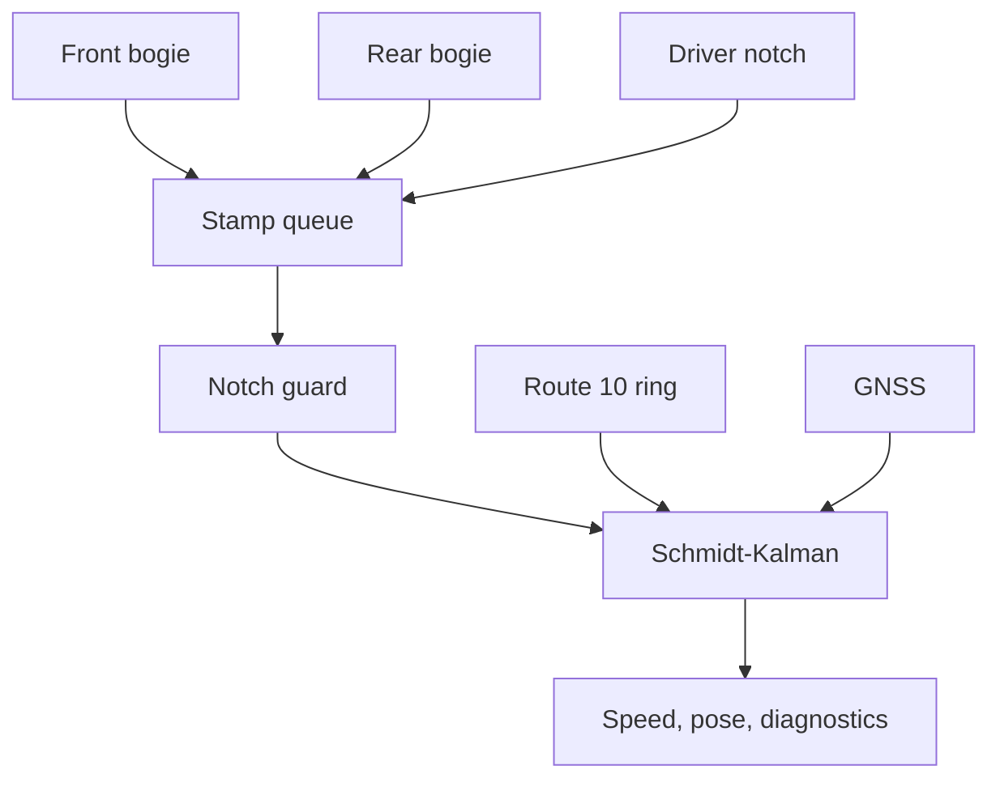

<p align="center">
  
  <br><br>
  <a href="docs/RailBreak_МТТЕХ_demo.pdf"></a>
  &nbsp;
  <a href="docs/RailBreak_МТТЕХ_demo.pptx"></a>
</p>

<p align="center">
  <a href="https://github.com/KonkovDV/RailBreak/actions/workflows/ci.yml"></a>
  &nbsp;
  
  &nbsp;
  
</p>

# RailBreak

[Русская версия](#ru)

**Model-informed backup odometry for the driverless tram on Moscow route 10.** A ROS 2 Humble / C++17 node that keeps longitudinal speed, 3D pose and an integrity verdict alive when satellite navigation drops out — using only two bogie speeds, the driver's controller handle and the geometry of the line.

| Official `hackathon_solution_checker`, bag `30618_88aea4d9`, `--rate 1` | RailBreak |
|---|---:|
| Position, 3D RMSE (max) | **1.158 m** (3.67 m) |
| Velocity RMSE (max) | **0.0247 m/s** (0.29 m/s) |
| Cross-track / along-track / vertical RMSE | 0.07 / 0.80 / 0.20 m |
| Input-to-publish latency, median / p95 / max | 0.20 / 0.63 / 100.7 ms |
| Memory / CPU | 24 MB RSS / 0.9 % of one core |

Held-out validation (21 rides, offline twin of the same filter): along-track RMSE median **1.47 m**, end-of-run drift **0.024 %** of distance, velocity RMSE **0.032 m/s**.

## Quick start

```text
# Docker, Linux / macOS / Git Bash
scripts/jury.sh play --bag <rosbag2 directory> --msgs <tram_vehicle_msgs>

# Docker, Windows PowerShell
.\scripts\jury.ps1 play -Bag <rosbag2 directory> -Msgs <tram_vehicle_msgs>

# Fail-closed acceptance: records outputs, scores them, checks >= 10 Hz, frames, monotonic stamps
scripts/jury.sh acceptance --bag <rosbag2 directory> --msgs <tram_vehicle_msgs>

# C++17 core unit tests: no Docker, no ROS, no bag
scripts/jury.sh core
```

Native Ubuntu 22.04 build, all launch scenarios and the topic contract are in the [Russian section](#ru) and in the [package README](railbreak_backup_odometry/README.md).

## How it works



1. **One coordinate along the rail.** The tram cannot leave the track, so the filter estimates arc length `s` on a `10,945.6099 m` WGS84-geodesic ring of route 10 and reads `x, y, z` and heading from the map. Cross-track error stays at **0.07 m** by construction.
2. **Four-state Schmidt–Kalman filter `[s, v, k, b_a]`.** Between bogie samples, speed follows an empirical traction/braking table `a_tab(n, v)` minus track grade `g·i(s)` plus an online bias `b_a`. Two wheels observe only `v/k`, so the wheel-scale gain is held at `K_k = 0` (Joseph-form update); `k` is refined by unambiguous station stops through `P_sk`.
3. **Soft down-weighting instead of hard switching.** A bogie that disagrees with the model (`ν²/S > 16`) or with the other bogie keeps contributing with `R = 25 (m/s)²`; the healthy bogie and the traction model carry the state.
4. **Bogie-mean speed output.** While both bogies are fresh and consistent, `/result/velocity` publishes their mean on a `0.04 s` grid and fades to the filter speed within `0.5 s` on disagreement or dropout.
5. **Controller-sign guard (`notch_fault`).** Agreeing bogies that accelerate under braking (or brake hard under traction) for `0.5 s` switch the model to coasting.
6. **Common-mode supervision.** Two bogies on one rail fail together. When both agree with each other and diverge from the model for `3 s`, the node enters `COMMON_MODE_UNOBSERVABLE`, freezes `k` and `b_a`, and waits for a station stop or an on-axis RTK burst; after `5 s` or `100 m` without one it reports `LOST` and keeps publishing pose with `σ = 1 km`.
7. **GNSS as an anchor, not a crutch.** A 3 s start window places the tram on the ring (dual-antenna heading); afterwards rare master-RTK bursts within `1.5 m` of the axis correct `s` without touching `k`. `gnss_correction: false` leaves only wheels, the traction model and the map after the start.

Full derivation: [model](docs/solution/model.md) · [assumptions and parameters](docs/solution/assumptions.md) · [architecture](docs/solution/architecture.md).

## Robustness on held-out rides

Offline twin of the filter (C++/Python lockstep within 0.37 mm), validation split, 21 rides; faults injected at speed after 25 % of the ride.

| Fault | Along-track RMSE, median (p95) | Velocity RMSE |
|---|---:|---:|
| none | 1.47 m (5.83 m) | 0.032 m/s |
| front bogie silent for 20 s | 1.60 m (5.7 m) | 0.032 m/s |
| both bogies silent for 20 s | 1.76 m (6.6 m) | 0.061 m/s |
| front bogie NaN for 10 s | 1.60 m (5.8 m) | 0.032 m/s |
| front bogie +10 % spin for 30 s | 1.94 m (10.5 m) | 0.035 m/s |
| both bogies −20 % slide for 8 s | 6.46 m (868 m) | 0.156 m/s |

No run produced a non-finite state. The common-slide tail is the ride where no unambiguous station follows the episode: the node withdraws position trust and reports `LOST` instead of trusting two agreeing wheels. Station anchors are the main accuracy source: without them the median grows to 12.6 m. Details: [results §4](docs/solution/results.md).

## Accuracy progression on the official check bag

| Stage | Position RMSE (max) | Velocity RMSE |
|---|---:|---:|
| `5cd35fa`, deadline submission | 2.151 m (5.649 m) | 0.051 m/s |
| Pathgraph axis + on-axis RTK bursts | 1.615 m (4.899 m) | 0.035 m/s |
| Agreed bogie-mean velocity | 1.372506 m (4.922128 m) | 0.026633 m/s |
| WGS84 geodesic ring, `k0` refit on train, 0.04 s grid | 1.163029 m (3.682215 m) | 0.024695 m/s |
| **Pose on bogie stamps (2026-10-03)** | **1.157702 m (3.674567 m)** | **0.024691 m/s** |

Every run, including `--rate 10` replays and the build without `DriverControllerCommand.msg` (1.325 m / 0.027 m/s), is logged in [results §9](docs/solution/results.md#9-журнал-checker). The check bag was not used to fit the map or `k0`; the `+0.105 s` velocity stamp offset is the measured lag of the reference topic behind the bogies on that recording and is a launch parameter.

## Design boundaries

| Capability | How RailBreak handles it |
|---|---|
| Single-bogie slip, spin, freeze, dropout, NaN | Detected and absorbed: the other bogie and the model carry the state |
| Simultaneous slide of both bogies | Detected as common mode, position trust withdrawn until the next anchor; making it *observable* needs a third independent speed channel (radar, IMU, magnetic signature), which is on the roadmap |
| Wheel–rail adhesion `μ` | Published as a residual proxy (`mu_estimate = null`): `μ` needs traction torque or an IMU, which the vehicle interface does not provide |
| Integrity bound | Empirical along-track bound calibrated on train, checked on val (97.2 % inside); diagnostic, not a certified protection level |
| Topology | One ring for the regular route; a branch-hypothesis bank for switches and depot exists as a prototype |

## Positioning against 2025–2026 work

- **Track-constrained 1D state is the current direction of rail navigation.** Zhang et al. (ION GNSS+ 2026) reach 1.335 m mileage RMSE and 0.0132 m/s over 30 km with a 1D INS/odometer filter; Zhang et al. (IEEE T-ITS 2025) fuse train motion with track-geometry features. RailBreak takes the same 1D formulation and reaches metre-level accuracy **without an IMU**, using the traction model and station anchors as the second channel.
- **Residual-driven uncertainty inflation** follows Palmer & Nourani-Vatani (IROS 2018) and the residual-aware DR-EKF of Jang et al. (arXiv:2604.02749, 2026), implemented as an O(1) NIS-gated variance switch that fits a 30 Hz real-time loop.
- **Integrity reporting** follows the accuracy-vs-integrity separation of Maharmeh et al. (Sensors 2025); online and multi-source conformal prediction (Lai & Raskutti 2026; Hore et al., arXiv:2609.14531) is the planned path to per-car calibrated bounds.
- **Adhesion and slide prediction** with learned models (Zha et al., Urban Rail Transit 2026; ETAE 2026 LSTM–Kalman observer) rely on braking force or torque inputs; RailBreak publishes an explainable residual card instead.

Full annotated bibliography and what was adopted from each source: [references](docs/solution/references.md).

## Repository map

| Path | Content |
|---|---|
| [`railbreak_backup_odometry/`](railbreak_backup_odometry/) | The ROS 2 package: node, header-only core, assets, launch, tests |
| [`docs/solution/`](docs/solution/) | Model, assumptions, results, requirements audit, integrity, references, pitch and demo |
| [`tools/`](tools/) | Offline twin, scorers, fault campaign, latency probe, map and table builders |
| [`scripts/`](scripts/) | Jury runner (`jury.sh`, `jury.ps1`), acceptance gate |
| `tram_dr_localization/`, `standalone/` | Research sandbox `tramDR-0.0.11` (12-state UKF on synthetic data); not linked into the node — see [docs/verification.md](docs/verification.md) |

---

<a id="ru"></a>

# RailBreak: резервная одометрия беспилотного трамвая маршрута № 10

**Пакет [`railbreak_backup_odometry`](railbreak_backup_odometry/) (ROS 2 Humble, C++17) вычисляет продольную скорость, 3D-положение и состояние достоверности беспилотного трамвая маршрута № 10 в Москве.**

Когда в городской застройке пропадает или начинает прыгать спутниковая навигация, у трамвая остаются скорости двух тележек, положение ручки контроллера и известная геометрия рельсового пути. RailBreak объединяет их в одномерном фильтре Шмидта — Калмана вдоль пути, удерживает траекторию на рельсах при сбоях одной или обеих тележек и в каждый момент сообщает потребителю, насколько можно доверять скорости и положению. IMU, лидар и камеры не используются.

## Содержание

- [Ключевые результаты](#ключевые-результаты)
- [Запуск для жюри](#запуск-для-жюри)
- [Как работает решение](#как-работает-решение)
- [Устойчивость к сбоям](#устойчивость-к-сбоям)
- [Эволюция точности](#эволюция-точности-на-проверочной-записи)
- [Сравнение с решениями трека и работами 2025–2026](#сравнение-с-решениями-трека-и-работами-20252026)
- [Границы применимости и план развития](#границы-применимости-и-план-развития)
- [Документация](#документация)
- [Сценарии запуска](#scenarios)
- [Официальный checker и замер задержки](#официальный-checker-и-замер-задержки)
- [Контракт топиков](#контракт-топиков-ros-2)
- [Сборка без Docker](#native)
- [CI и права](#ci-и-права)

## Ключевые результаты

Официальный `hackathon_solution_checker` организатора (`metrics.py`, `ApproximateTimeSynchronizer`, очередь `100`, допуск `0.05 с`), проверочная запись `30618_88aea4d9`, прогон 2026-10-03, `ros2 bag play --rate 1`:

| Метрика | Значение |
|---|---:|
| RMSE положения 3D (максимум) | **1.157702 м** (3.674567 м) |
| RMSE по осям x / y / z | 0.888 / 0.715 / 0.202 м |
| RMSE скорости (максимум) | **0.024691 м/с** (0.289518 м/с) |
| Поперёк / вдоль пути | 0.072 / 0.799 м |
| Задержка вход → публикация: медиана / p95 / p99 / максимум | 0.20 / 0.63 / 1.09 / 100.7 мс |
| Память / CPU | 24.1 МБ RSS / 0.89 % одного ядра |
| Частота `/result/velocity` | 29.47 Гц уникальных штампов |

На отложенной выборке `val` (21 рейс, Python-двойник того же фильтра) медиана RMSE вдоль пути **1.47 м** (p95 5.83 м), RMSE скорости **0.032 м/с**, дрейф в конце рейса **0.024 %** пути. Тот же бинарник при `--rate 10` даёт 1.159811 м и 0.024686 м/с — результат не зависит от скорости воспроизведения.

## Запуск для жюри

Требуется Docker (Docker Desktop на Windows и macOS, Docker Engine с Compose на Linux). Из корня клона:

```text
scripts/jury.sh play --bag <каталог rosbag2> --msgs <tram_vehicle_msgs>
.\scripts\jury.ps1 play -Bag <каталог rosbag2> -Msgs <tram_vehicle_msgs>
```

Контейнер собирает пакет вместе с пакетом сообщений организатора и проигрывает запись; после загрузки базового образа Humble сеть не нужна. Записи `rosbag2` и `tram_vehicle_msgs` в репозиторий не входят, карта маршрута (`assets/`) встроена в пакет.

**Используйте полный `tram_vehicle_msgs` из датасета.** В архиве `check-code-with-bag.zip` нет `DriverControllerCommand.msg`; с таким пакетом нода автоматически собирается в режиме двух тележек при нулевой ручке (`notch_input = type_absent`) и даёт 1.325 м / 0.027 м/с на той же записи.

Что появляется на выходе:

- `/result/velocity` (`tram_vehicle_msgs/VelocitySensor`) — с первого сообщения тележки, продольная скорость в м/с;
- `/result/position` (`nav_msgs/Odometry`) — после 3-секундного стартового окна GNSS: `frame_id = map`, `child_frame_id = base_link`, `x` в квадрате MGRS 37U CB около `99–103 км`;
- `/result/diagnostics` (`diagnostic_msgs/DiagnosticArray`) — режим, целостность, доверие каналов; после стартового окна `gnss = correcting` (по умолчанию) или `gnss = closed` при `gnss_correction: false`.

Автоматическая приёмка с кодом возврата (`0` — все проверки пройдены):

```text
scripts/jury.sh acceptance --bag <каталог rosbag2> --msgs <tram_vehicle_msgs>
.\scripts\jury.ps1 acceptance -Bag <каталог rosbag2> -Msgs <tram_vehicle_msgs>
```

`acceptance` записывает выходные топики, считает метрики `score_ros.py` и завершается ненулевым кодом, если нода упала, нет скорости или положения, штамп шагнул назад, частота уникальных штампов ниже `10 Гц`, разрыв больше `0.25 с`, кадры отличаются от `map` / `base_link` или стартовое окно GNSS не закрылось. На учебной записи `30618_e9a34502`: код `0`, 3D `0.773 м`, `29.2 Гц`, 10 якорей станций.

## Как работает решение

| Этап | Вход | Выход |
|---|---|---|
| Входы | `/vehicle/front_bogie_velocity`, `/vehicle/rear_bogie_velocity` (км/ч, ~10 Гц); `/vehicle/driver_position_cmd` (−15…+15); `/sensing/gnss/master/fix`, `/sensing/gnss/rover/fix` | Стартовое окно 3 с, затем редкие пачки master RTK на оси пути |
| Фильтр вдоль пути | Очередь штампов, защита знака ручки, состояние `[s, v, k, b_a]`, кольцо `10 945.6099 м` | `K_k = 0` на колёсном шаге; масштаб `k` уточняют якоря станций |
| Публикация | Среднее тележек на сетке `0.04 с`, поза на штампе тележки и сохранённая дуга между штампами, карточка достоверности | `/result/velocity`, `/result/position`, `/result/diagnostics` |

1. **Одна координата вдоль рельсов.** Трамвай связан колеёй, поэтому фильтр оценивает дугу `s` вдоль геодезического кольца маршрута № 10 (`assets/ring.csv`, `10 945.6099 м` в WGS84), а `x, y, z` и ориентацию берёт из карты с пересчётом от антенны master к `base_link` (`+9.873 м` вдоль пути, `−3.0 м` по высоте). Ковариация положения проецируется касательной `t = (p(s+2) − p(s−2)) / 4`: `Σ_xyz = Var(s_pub) · t tᵀ`. Поперечная ошибка на проверочной записи — **0.072 м**.
2. **Фильтр Шмидта — Калмана `[s, v, k, b_a]`.** Между отсчётами тележек скорость интегрируется по таблице тяги и торможения `a_tab(n, v)` (`assets/notch.csv`, снята с train) за вычетом уклона `g · i(s)` со смещением `b_a`. По двум колёсам наблюдаемо только отношение `v / k`, поэтому на колёсном шаге усиление по масштабу обнулено (`K_k = 0`, обновление в форме Джозефа): погрешность таблицы тяги не утекает в радиус колеса. Масштаб `k` уточняется на однозначных стоянках у станций (`assets/stops.csv`, разброс `≤ 3 м`, ворота `3σ`, `ZUPT`) через ковариацию `P_sk`.
3. **Мягкое снижение веса вместо отключения датчика.** Тележка, разошедшаяся с моделью (`ν² / S > 16`) или с соседней, остаётся в фильтре с `R = 25 (м/с)²`; траекторию ведут здоровая тележка и модель тяги.
4. **Защита знака ручки (`notch_fault`).** Если согласованные тележки быстрее `1 м/с` дольше `0.5 с` ускоряются (`a > 0.25 м/с²`) при тормозной ручке (`notch ≤ −4`) или замедляются сильнее `1.0 м/с²` при ходовой (`notch ≥ +4`), модель переходит на выбег (`notch = 0`).
5. **Выход на сетке `0.04 с`.** Пока обе тележки свежие и согласны, `/result/velocity` публикует их среднее на сетке `0.04 с` со сдвигом штампа `output_stamp_offset_s = +0.105 с` (измеренный лаг эталона `/localization/kinematic_state` относительно тележек; параметр конфигурации). При расхождении или обрыве выход за `0.5 с` переходит на скорость фильтра. Положение выходит со штампом тележки и строго между штампами — по сохранённой дуге с шагом `0.04 с` (разрывы длиннее `1 с` и скачки дуги больше `8 м` не заполняются).
6. **Контроль общей моды и карточка `advisory_class`.** Две тележки на одном рельсе не независимы: при синхронном юзе они согласны друг с другом и расходятся с моделью. Через `3 с` такого расхождения фильтр переходит в `COMMON_MODE_UNOBSERVABLE`, замораживает `k` и `b_a` и ждёт станцию или пачку RTK на оси. Через `5 с` или `100 м` без якоря — статус `LOST`: положение продолжает публиковаться с `σ = 1 км` и `integrity_use_position = false`. Карточка `advisory_class` (`input_quality`, `common_mode`, `one_bogie_residual`, `both_residual`, `nominal`) отделяет плохой вход от физической невязки.
7. **GNSS — якорь, а не костыль.** Окно `3 с` ставит вагон на кольцо (среднее дуг двух антенн и азимут master→rover). Затем при `gnss_correction: true` каждое непрерывное окно master RTK (`status = 2`) не дальше `1.5 м` от оси один раз корректирует `s`, не трогая `k`. `gnss_correction: false` отписывает GNSS после старта — чистая одометрия по тележкам и модели.

Подробно: [модель](docs/solution/model.md), [допущения и параметры](docs/solution/assumptions.md), [архитектура](docs/solution/architecture.md), [граница целостности](docs/solution/integrity.md).

## Устойчивость к сбоям

Отложенная выборка `val`, 21 рейс, сбой накладывается на ходу (скорость > 20 км/ч, после 25 % рейса). Python-двойник совпадает с C++-ядром до 0.37 мм по пути (`tools/organizer/lockstep.py`).

| Сбой | RMSE вдоль пути, медиана (p95) | RMSE скорости | Поведение |
|---|---:|---:|---|
| Без сбоя | 1.47 м (5.83) | 0.032 м/с | — |
| Передняя тележка молчит 20 с | 1.60 м (5.7) | 0.032 м/с | Путь ведёт задняя тележка |
| Обе тележки молчат 20 с | 1.76 м (6.6) | 0.061 м/с | Путь ведёт модель тяги по ручке и уклону |
| Передняя тележка NaN 10 с | 1.60 м (5.8) | 0.032 м/с | Отсев на входе |
| Передняя +10 % на 30 с (боксование) | 1.94 м (10.5) | 0.035 м/с | Флаг в 95 % рейсов, `R = 25 (м/с)²` |
| Обе −20 % на 8 с (юз) | 6.46 м (868.5) | 0.156 м/с | Флаг в 95 % рейсов, `COMMON_MODE_UNOBSERVABLE` до якоря; хвост p95 — рейсы без однозначной станции до конца, там `LOST` |

Ни в одном прогоне состояние не стало NaN или Inf. Главный вклад в точность дают якоря станций: без них медиана вдоль пути 12.6 м. Полная матрица, включая постоянный масштаб одной тележки и пятикратный шум, — в [results.md §4](docs/solution/results.md).

## Эволюция точности на проверочной записи

| Этап | Что изменилось | Положение, м (макс.) | Скорость, м/с | Пары (поз. / скор.) |
|---|---|---:|---:|---:|
| `5cd35fa`, сдача к дедлайну | Выход на каждый вход, сферическая дуга, скорость фильтра | 2.151 (5.649) | 0.051 | 50 168 / 50 481 |
| Pathgraph и окна RTK | Ось pathgraph в кольце, медиана каждой пачки master RTK на оси | 1.615 (4.899) | 0.035 | 49 768 / 50 006 |
| Среднее согласных тележек | `wheels_mean`, штамп `+0.105 с`, ручка вне водяного знака | 1.372506 (4.922128) | 0.026633 | 49 956 / 12 205 |
| Геодезическое кольцо WGS84 | Точная длина `ring.csv`, `k0 = 1.001378` по train, сетка скорости `0.04 с` | 1.163029 (3.682215) | 0.024695 | 49 940 / 38 388 |
| `9a954fd`, хорда шва | Интерполяция 4.25-метрового замыкания кольца | 1.164429 (3.684696) | 0.024692 | 49 943 / 38 392 |
| **2026-10-03, поза на штампе тележки** | **Ручка больше не публикует позу** | **1.157702 (3.674567)** | **0.024691** | **24 376 / 38 396** |

Полный журнал из 18 прогонов, разложение по 120-секундным окнам и прогоны `--rate 10` — в [results.md §9](docs/solution/results.md#9-журнал-checker). Карта и `k0` строились только по `train`; проверочная запись в их подгонке не участвовала. Сетка положения `0.04 с` включена после прогона 2026-10-03: на штампах тележек той же записи она даёт 38 743 уникальных штампа (29.493 Гц, максимальный разрыв 0.040 с, 0 шагов назад).

## Сравнение с решениями трека и работами 2025–2026

Числа других команд на записи `30618_88aea4d9` — из их README и отчётов (собраны в [references.md](docs/solution/references.md)); в нашем Docker их узлы не перезапускались.

| Решение | Подход | Скорость, м/с | Положение 3D, м |
|---|---|---:|---:|
| **RailBreak** | **Шмидт — Калман `[s, v, k, b_a]`, геодезическое кольцо, среднее тележек, `notch_fault`, монитор целостности** | **0.024691** | **1.157702** (макс. 3.67) |
| `67-time-to-win-hack` (`tbo_core`) | GPB1 на пяти режимах, CUSUM, масштаб по кванту скорости, западный тупик в карте | 0.026 | 0.60 |
| `ekimlichenko-mt` | Одномерный оцениватель с GNSS по ходу рейса | 0.0324 | 1.111 (макс. 14.02) |
| `VECTRA` | UKF `[s, v, d, k_т, k_б]`, сопротивление Дэвиса, сдвиг скорости 0.08 с | 0.042 | 1.43 |
| `tram-backup-odometry` | Эхо-сеть и Калман `[v, b]` | 0.051 | 1.209 |
| `dub-otrezkov` | Проекция на путь | 0.055 | 1.053 (макс. 13.17) |
| `FunnyRepo` | Таблица 31×16, задержка тяги 0.4 с | 0.033 | 5.13 |

RailBreak даёт лучшую скорость среди опубликованных результатов трека; максимум ошибки положения 3.67 м против 13–14 м у решений, опубликовавших максимум.

**Место в литературе 2025–2026.**

1. **Одномерное состояние вдоль пути — магистральное направление рельсовой навигации.** Zhang и др. (ION GNSS+ 2026) получают RMSE пробега 1.335 м и скорости 0.0132 м/с на 30 км одномерным фильтром INS/одометр; Zhang и др. (IEEE T-ITS 2025) уточняют положение метропоезда сопоставлением движения с геометрией пути. RailBreak использует ту же постановку и выходит на метровую точность **без IMU**: второй канал — модель тяги и якоря станций.
2. **Раздувание дисперсии по невязке** следует Palmer, Nourani-Vatani (IROS 2018) и residual-aware DR-EKF Jang и др. (arXiv:2604.02749, 2026) в виде O(1)-правила по NIS, которое укладывается в цикл 30 Гц без онлайн-решения SDP.
3. **Отчёт о целостности** построен на разделении точности и целостности (Maharmeh и др., Sensors 2025). Онлайн- и многоисточниковое конформное предсказание (Lai, Raskutti, 2026; Hore и др., arXiv:2609.14531) — следующий шаг к калиброванной по вагону границе.
4. **Сцепление и прогноз юза.** Обученные детекторы (Zha и др., Urban Rail Transit 2026; LSTM–Калман, ETAE 2026) опираются на тормозное усилие или момент. В интерфейсе вагона их нет, поэтому RailBreak публикует объяснимую карточку невязок с `mu_estimate = null`.

Из соседних репозиториев ([wellguard-os](https://github.com/KonkovDV/wellguard-os), [open-integrity-twin](https://github.com/KonkovDV/open-integrity-twin), [drillguard-os](https://github.com/KonkovDV/drillguard-os)) перенесена детерминированная карточка `advisory_class`.

## Границы применимости и план развития

| Область | Текущее решение | Следующий шаг |
|---|---|---|
| Юз одной тележки, боксование, обрыв, NaN | Обнаружение и компенсация второй тележкой и моделью | — |
| Синхронный юз обеих тележек | Обнаружение, снятие доверия к положению до якоря, `LOST` по слепому бюджету | Третий независимый канал скорости: радар, IMU или магнитная подпись пути (Dieckow и др., 2025) |
| Коэффициент сцепления `μ` | Прокси невязок, `mu_estimate = null` | Нужен момент тяги/торможения или IMU |
| Граница вдоль пути | Эмпирическая граница по train, на val внутри 97.2 % фиксов | Онлайн-конформная калибровка по вагонам |
| Масштаб вагона | `k0` вагона 30618; вагон 30639 на той же карте отличается на ~1.2 % | Калибровка `k0` по вагону, многоисточниковая калибровка |
| Топология | Одно кольцо регулярного маршрута | Банк гипотез пути на стрелках и в депо ([прототип](docs/solution/hypotheses.md)) |
| Задержка привода | Таблица установившегося ускорения | Состояние задержки, проверенное в теневом банке моделей |

Сводный план по порядку пользы — [tz-audit.md](docs/solution/tz-audit.md#план-развития).

## Документация

| Документ | Содержание |
|---|---|
| [Пакет `railbreak_backup_odometry`](railbreak_backup_odometry/README.md) | Входы и выходы, сборка без интернета, параметры, диагностика, поведение при сбоях |
| [Математическая модель](docs/solution/model.md) | Состояние `[s, v, k, b_a]`, таблица тяги, фильтр Шмидта — Калмана, наблюдаемость, якоря |
| [Допущения и параметры](docs/solution/assumptions.md) | Единицы, геометрия `base_link`, MGRS 37U CB, полная таблица параметров |
| [Методика и результаты](docs/solution/results.md) | Официальный checker, `val`, абляции, сбои, реальное время, журнал прогонов |
| [Соответствие ТЗ и план](docs/solution/tz-audit.md) | Построчная сверка с кейсом и план развития |
| [Архитектура](docs/solution/architecture.md), [целостность](docs/solution/integrity.md), [сцепление](docs/solution/adhesion.md) | Слои вокруг фильтра |
| [Источники](docs/solution/references.md) | Литература 2012–2026 и что взято из каждой работы |
| [Инженерный журнал](POSTMORTEM.md) | Изменения после отбора: что вошло, что проверено и отклонено |
| [Демо](docs/solution/demo.md) и [питч](docs/solution/pitch.md) | Три акта живой демонстрации и пятиминутный доклад |
| [Карта документации](docs/README.md) | Все документы, включая исследовательский стенд и внешний аудит |

---

<a id="scenarios"></a>

## Сценарии запуска (`jury.sh` / `jury.ps1`)

```text
scripts/jury.sh  <сценарий> --bag <каталог rosbag2> --msgs <tram_vehicle_msgs>
scripts/jury.ps1 <сценарий> -Bag <каталог rosbag2> -Msgs <tram_vehicle_msgs>
```

| Сценарий | Что проверяет |
|---|---|
| `play` | Полный прогон записи в кадре `mgrs`, без `/clock` |
| `smoke` | Быстрая проверка первых 25 секунд записи |
| `acceptance` | Запись выхода, метрики `score_ros.py` и fail-closed проверки (код `0` — всё прошло) |
| `record` | Запись выхода и расчёт метрик в интерактивном режиме |
| `clock` | Запуск с `use_sim_time:=true` и `ros2 bag play --clock` |
| `fast` | Ускоренное воспроизведение `--rate 10` (логика, не замер задержки) |
| `frame` | Локальная сетка от старта (`output_frame:=mkrs_start`) |
| `no-gnss` | Прогон без топиков GNSS (относительная одометрия от точки старта) |
| `no-assets` | Без каталога карт (`assets_dir:=/nonexistent`): нода жива, выдаёт пройденный путь по `x`, `y = z = 0` |
| `arc` | Старт без GNSS с заданной дуги (`--initial-s` / `-InitialS`) |
| `core` | Сборка CMake и модульные тесты ядра C++17 без Docker, ROS и `rosbag2` |

## Официальный checker и замер задержки

Пакет `hackathon_solution_checker` из архива `check-code-with-bag.zip` собирается в одном рабочем пространстве с нодой (`tram_vehicle_msgs` для полного прогона — из датасета):

```text
colcon build --packages-select tram_vehicle_msgs railbreak_backup_odometry hackathon_solution_checker
ros2 run railbreak_backup_odometry backup_odometry_node       # терминал 1
ros2 run hackathon_solution_checker metrics                   # терминал 2, итог после Ctrl+C
ros2 bag play <каталог rosbag2> --rate 1                      # терминал 3
```

Задержка вход→выход: запишите три входных топика, `/result/position` и `/result/velocity` через `ros2 bag record` при `--rate 1`, затем:

```text
python3 tools/organizer/latency_probe.py --bag <записанный_bag> --output-topic /result/position
```

Скрипт считает разность времени приёма выхода и входа с тем же `header.stamp`. Поле `callback_max_us` в `/result/diagnostics` — длительность одного колбэка внутри процесса.

## Контракт топиков ROS 2

| Направление | Топик | Тип | Описание |
|---|---|---|---|
| **Вход** | `/vehicle/front_bogie_velocity`, `/vehicle/rear_bogie_velocity` | `tram_vehicle_msgs/msg/VelocitySensor` | Скорости тележек (в записях — км/ч; нода делит на `3.6`) |
| **Вход** | `/vehicle/driver_position_cmd` | `tram_vehicle_msgs/msg/DriverControllerCommand` | Позиция ручки `−15..+15` (отрицательная — торможение, положительная — тяга) |
| **Вход** | `/sensing/gnss/master/fix`, `/sensing/gnss/rover/fix` | `sensor_msgs/msg/NavSatFix` | Стартовое окно `3 с` и редкие окна master RTK на оси пути |
| **Выход** | `/result/velocity` | `tram_vehicle_msgs/msg/VelocitySensor` | Продольная скорость, м/с (сетка `0.04 с`, штамп `+0.105 с`) |
| **Выход** | `/result/position` | `nav_msgs/msg/Odometry` | Точка `base_link` в MGRS 37U CB (`map` → `base_link`), скорость в `twist.twist.linear.x`; при запрете целостности `σ = 1 км` |
| **Выход** | `/result/diagnostics` | `diagnostic_msgs/msg/DiagnosticArray` | Режим, целостность, доверие каналов, `advisory_class`, `notch_fault`, GNSS, очередь штампов |

<a id="native"></a>

## Сборка без Docker: Ubuntu 22.04 и ROS 2 Humble

Нужен установленный ROS 2 Humble (`rclcpp`, `nav_msgs`, `sensor_msgs`, `diagnostic_msgs`, `ament_index_cpp`, `launch_ros`, `ros2 bag`). Интернет и `rosdep` для сборки пакета не нужны.

### 1. Сборка рабочего пространства

```bash
mkdir -p ~/ws/src
cp -a railbreak_backup_odometry ~/ws/src/
cp -a <датасет>/tram_vehicle_msgs ~/ws/src/
# В выданном package.xml нет тега <maintainer>, обязательного для catkin_pkg в Humble
source scripts/ensure_maintainer.sh
ensure_maintainer ~/ws/src/tram_vehicle_msgs/package.xml
cd ~/ws
source /opt/ros/humble/setup.bash
colcon build --packages-select tram_vehicle_msgs railbreak_backup_odometry \
  --cmake-args -DCMAKE_BUILD_TYPE=Release
source install/setup.bash
ros2 pkg executables railbreak_backup_odometry   # backup_odometry_node, replay_events
```

### 2. Штатный прогон записи

Запускайте ноду **до** проигрывателя, чтобы не пропустить стартовое окно GNSS (если окно всё же пропущено, нода захватит абсолютную дугу на первой пачке master RTK на оси):

```bash
# Терминал 1
ros2 launch railbreak_backup_odometry backup_odometry.launch.py
# Терминал 2 — после строки "assets ...: ring ... m" в логе
ros2 bag play /путь/к/каталогу_bag --rate 1
# Терминал 3
ros2 topic hz /result/velocity
ros2 topic echo /result/position --field pose.pose.position
ros2 topic echo /result/diagnostics --field status[0].values
```

### 3. `/clock` и ускоренный прогон

По умолчанию `use_sim_time` выключен: интегратор работает по `header.stamp` входов. С `/clock`:

```bash
ros2 launch railbreak_backup_odometry backup_odometry.launch.py use_sim_time:=true
ros2 bag play /путь/к/каталогу_bag --clock --rate 1
```

`--rate 10` подходит для проверки логики (очередь подписки `500`); задержку по ТЗ меряют при `--rate 1`.

### 4. Оценка на учебных записях (`score_ros.py`)

В учебных записях нет `/localization/kinematic_state`, поэтому `score_ros.py` восстанавливает `base_link` по отрезку антенн master→rover (база `12.436 ± 2 м`, разность высот `≤ 1 м`):

```bash
ros2 bag record -o /tmp/result_bag /result/velocity /result/position /result/diagnostics
python3 tools/organizer/score_ros.py /tmp/result_bag /путь/к/исходному_bag --frame mgrs
```

### 5. Кадры и особые старты

- Локальная сетка от старта: `output_frame:=mkrs_start` (также `mgrs`, `mkrs`, `grid_start`, `enu`).
- Свой каталог карт без пересборки: `assets_dir:=/путь/к/assets`.
- Старт без GNSS: `-p initial_lat_deg:=55.810417 -p initial_lon_deg:=37.462308` или `-p initial_s_m:=1234.0`. Если за 10 с нет ни GNSS, ни начальной точки, нода выдаёт относительный путь от нуля.
- Без карты (`assets_dir:=/nonexistent`): нода пишет `assets not loaded` и выдаёт скорость и пройденный путь по `x`.

### 6. Ядро C++17 без ROS 2

Математическое ядро в `include/railbreak_backup_odometry/` не зависит от ROS 2 и собирается на любой ОС с CMake 3.14+:

```bash
cmake -S railbreak_backup_odometry/tools -B build/rbo -DCMAKE_BUILD_TYPE=Release
cmake --build build/rbo --config Release --parallel
ctest --test-dir build/rbo -C Release --output-on-failure
```

## CI и права

- **Публичный CI (`.github/workflows/ci.yml`):** собирает ядро сдаваемого пакета и исследовательский стенд, прогоняет их под `AddressSanitizer` + `UndefinedBehaviorSanitizer`, запускает Python-тесты двойника, скореров, монитора целостности, кампании сбоев и документации, собирает `railbreak_backup_odometry` в контейнере ROS 2 Humble с полным стабом [ci/tram_vehicle_msgs](ci/tram_vehicle_msgs/) и без `DriverControllerCommand.msg`.
- **Исследовательский стенд `tramDR-0.0.11`:** каталоги `tram_dr_localization` и `standalone` — ранний 12-мерный UKF на синтетике ([docs/verification.md](docs/verification.md)); нода сдачи их не использует.
- **Права:** код передаётся организаторам по условиям хакатона; сторонние компоненты и данные — [NOTICE](NOTICE) и [THIRD_PARTY_NOTICES.md](THIRD_PARTY_NOTICES.md). Происхождение модулей — [PROVENANCE.md](PROVENANCE.md).
