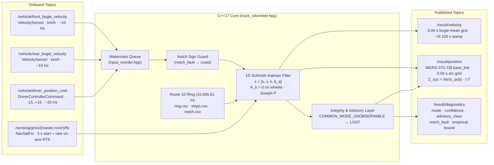

<p align="center"></p>

<p align="center">
  <a href="docs/RailBreak_МТТЕХ_demo.pdf"></a>
  &nbsp;
  <a href="docs/RailBreak_МТТЕХ_demo.pptx"></a>
</p>

<p align="center"><a href="https://github.com/KonkovDV/RailBreak/actions/workflows/ci.yml"></a></p>

# RailBreak

**Model-informed backup odometry for the driverless tram on Moscow route 10 (`railbreak_backup_odometry`, ROS 2 Humble, C++17).**

When a tram enters an urban canyon or loses satellite reception, it still has two bogie speed channels, the driver's controller handle, and the geometry of the rail line it runs on. [`railbreak_backup_odometry`](railbreak_backup_odometry/) turns those minimal onboard signals into continuous longitudinal speed (`/result/velocity`), 3D position in MGRS 37U CB (`/result/position`, `map` → `base_link`), and a structured integrity card (`/result/diagnostics`).

The repository contains two distinct layers:
- **[`railbreak_backup_odometry/`](railbreak_backup_odometry/)** — the standalone ROS 2 Humble C++17 package evaluated by the jury. After Humble and the organizer package `tram_vehicle_msgs` are already installed, the package builds without network access. `tram_vehicle_msgs` is not a stock Humble package.
- **`tramDR-0.0.11`** (`tram_dr_localization/`, `standalone/`) — an earlier synthetic UKF research sandbox kept in the repository for reference; the ROS 2 submission node does not import or link against it.

---

## Architecture



### How the estimator works

1. **1D state along the track.** Instead of integrating a free 2D/3D pose that drifts sideways on turns, the filter tracks arc length `s` along the `10,945.6099 m` WGS84 geodesic ring of route 10 (`assets/ring.csv`). Published `x, y, z` and orientation are the projection of `s` onto the track centerline, shifted from the master antenna to `base_link` (`+9.873 m` along the track, `-3.0 m` vertically) in MGRS square 37U CB (`300000 E`, `6100000 N`). Pose covariance is projected into the output frame via the local tangent chord `t = (p(s+2) - p(s-2)) / 4` as `Σ_xyz = Var(s_pub) · t tᵀ`.
2. **Four-state Schmidt–Kalman filter `[s, v, k, b_a]`.** Between bogie updates, speed is propagated by the empirical traction/braking table `a_tab(n, v)` (`assets/notch.csv`) minus track grade `g · i(s)` plus an online acceleration bias `b_a` (`Adaptive drive surrogate with online bias/scale diagnostics; not unique physical mass identification.`). On wheel updates, the Kalman gain on wheel scale is fixed to zero (`K_k = 0`) with Joseph-form covariance updates so traction-table errors never leak into the wheel scale `k`. Only unambiguous station stops (`assets/stops.csv`, spread `≤ 3 m` inside a `3σ` gate during a standstill `ZUPT`) update `s` and adjust `k` through cross-covariance `P_sk`.
3. **Soft variance inflation instead of hard sensor switching.** When a bogie diverges from the model (`ν² / S > 16`) or from the other bogie, it is not discarded; its measurement variance is inflated to `R_bad = 25 (m/s)²` while the healthy bogie and traction model carry the state.
4. **Agreed bogie mean for speed output.** While both bogies are fresh and consistent, `/result/velocity` publishes their mean on a `0.04 s` grid with a `+0.105 s` stamp offset matching the reference recording; if a bogie slips or drops out, the output smoothly fades over `0.5 s` to the Kalman filter speed.
5. **Controller-sign consistency guard (`notch_fault`).** When both bogies agree and move above `1 m/s`, accelerating (`a > 0.25 m/s²`) under braking (`notch ≤ -4`) or decelerating (`a < -1.0 m/s²`) under traction (`notch ≥ +4`) for at least `0.5 s` sets `notch_fault = true` and switches the model prediction to coasting (`notch = 0`). The acceleration sample is an agreeing pair `0.25–0.60 s` apart; a longer gap resets that window. The guard never clears an already latched `COMMON_MODE_UNOBSERVABLE` state.
6. **Startup GNSS and optional on-axis RTK bursts.** A 3-second startup window locks the initial arc `s` and travel direction (using the master→rover vector). With `gnss_correction: true` (default), contiguous master RTK bursts (`status = 2`) within `1.5 m` cross-track and `max(5 m, 4σ_s)` along-track correct `s` without touching `k` (`gnss_correction: false` unsubscribes both GNSS topics after startup).

---

## Capabilities and Hard Boundaries

| What the node does | What it refuses to claim |
|---|---|
| Tracks 1D arc `s` along route 10 and outputs 3D `base_link` pose in MGRS 37U CB | Does not claim SIL, ETCS compliance, or a certified protection level (`empirical bound, not certified protection level`) |
| Publishes agreed bogie-mean speed on a `0.04 s` grid (`0.024691 m/s` checker RMSE) | Does not estimate wheel–rail adhesion `μ` (`coefficient of adhesion is not observable from two wheel speeds and driver command alone.`, `mu_estimate = null`) |
| Tracks online acceleration bias `b_a` and noise `R` (`Adaptive drive surrogate with online bias/scale diagnostics; not unique physical mass identification.`) | Does not identify physical tram mass, motor torque, or independent bogie scale factors inside the Kalman gain (`K_k = 0` on wheels) |
| Detects contradictory controller notches (`notch_fault`) and falls back to coasting | Does not treat mutual bogie agreement after `3 s` of shared residual as recovery (`COMMON_MODE_UNOBSERVABLE` waits for a station stop or RTK burst, then declares `LOST`) |
| Emits an operator diagnostic card (`advisory_class`: `input_quality`, `common_mode`, `one_bogie_residual`, `both_residual`, `nominal`) | Does not treat heuristic scores as probabilities or silence `/result/position` in `LOST` (continues publishing with `σ = 1 km` and `integrity_use_position = false`) |

---

## What We Learned from the Data and Rides

- **Bogie speed topics carry km/h, not m/s.** Although the dataset note describes `/vehicle/*_bogie_velocity` as m/s, the median ratio to GNSS ground speed across 79 rides with valid GNSS is `3.597` (5–95%: `3.585–3.632`). The node scales raw wheel speeds by `wheel_unit_scale = 1 / 3.6`.
- **The organizer reference has a recording lag relative to the bogies.** On training rides, master GNSS speed and bogie speeds align at zero lag. On the check bag `30618_88aea4d9`, `/localization/kinematic_state` lags the bogies by `+0.105 s` in velocity and `~0.05 s` in position. Shifting `/result/velocity` headers by `+0.105 s` and taking `output_pos_lag_s = 0.05 s` along the arc removes that systematic offset without retuning the filter.
- **Publishing pose on the command topic hurts both latency and pairing.** Driver controller commands arrive at ~20 Hz and hold the watermark queue when paired with 10 Hz bogie topics. Emitting `/result/position` on bogie stamps (and resampling stored arc at `0.04 s` strictly between bogie stamps) dropped median processing-to-publish latency from `52.6 ms` to `0.20 ms` (`p95 = 0.63 ms`, peak `100.7 ms`).
- **Local spherical meters shorten east–west tracks.** At Moscow's latitude (`55.8° N`), a spherical radius (`6,378,137 m`) shortens east–west segments by `0.22%` relative to the WGS84 geodesic. Recomputing `assets/ring.csv` to arc length `10,945.6099 m` and refitting `k0 = 1.001378` on the 55 training master-RTK windows (val `0.999852` stayed out of the fit) moved the official checker from `1.372506 m` to `1.163029 m`. The later bogie-stamped pose, a separate change, is `1.157702 m`.
- **Two bogies on the same rail are not independent witnesses.** Under simultaneous braking slide or a shared wheel-diameter offset, front and rear bogies agree closely with each other while diverging from the traction model. After `3 s` of shared divergence, the node latches `COMMON_MODE_UNOBSERVABLE`; if `5 s` or `100 m` pass without a station stop or on-axis RTK burst, it transitions to `LOST` rather than trusting mutual wheel agreement.

---

## Measured Results

### 1. Accuracy progression on the official check bag (`30618_88aea4d9`)

Evaluated in Docker with the organizer's `hackathon_solution_checker` (`ApproximateTimeSynchronizer`, `queue_size = 100`, `slop = 0.05 s`). Full run-by-run history (18 runs and 120-second slices) is in [`docs/solution/results.md` §9](docs/solution/results.md).

| Stage / Commit | What changed | Rate | Position RMSE, m (max) | Velocity RMSE, m/s (max) | Pairs (pos / vel) |
|---|---|---:|---:|---:|---:|
| `5cd35fa` (submission baseline) | One output per event, spherical arc, filter velocity | `1x` | 2.151 (5.649) | 0.051 (0.337) | 50,168 / 50,481 |
| `+0.10 s` vel stamp & on-axis RTK | `+0.10 s` velocity delay, dual-antenna start, master RTK bursts | `10x` | 1.624 (4.909) | 0.034 (0.325) | 49,776 / 41,383 |
| Agreed bogie-mean velocity | `wheels_mean` with `+0.105 s` stamp offset and `0.05 s` arc lag | `1x` | 1.372506 (4.922128) | 0.026633 (0.289518) | 49,956 / 12,205 |
| WGS84 geodesic ring + `0.04 s` vel grid | Geodesic `ring.csv`, `k0 = 1.001378` from train, `0.04 s` velocity grid | `1x` | 1.163029 (3.682215) | 0.024695 (0.289518) | 49,940 / 38,388 |
| `9a954fd` (closing-seam chord) | Linear `x, y, z` interpolation across the 4.25 m ring seam | `1x` | 1.164429 (3.684696) | 0.024692 (0.289518) | 49,943 / 38,392 |
| **Bogie-stamped pose (2026-10-03)** | **Pose emitted on bogie stamp (no command-stamped pose)** | **`1x`** | **1.157702 (3.674567)** | **0.024691 (0.289518)** | **24,376 / 38,396** |
| Bogie-stamped pose (`--rate 10`) | Same binary replayed at `10x` speed | `10x` | 1.159811 (3.676738) | 0.024686 (0.289518) | 24,355 / 38,306 |
| Without `DriverControllerCommand.msg` | Later tree, notch held at 0 (`e863195` was 5.454 m / 0.044 m/s, 25,488 / 25,511 pairs) | `1x` | 1.325 (4.806) | 0.027 (0.341) | 25,406 / 25,429 |

Against the nearest reference stamp within `0.05 s` (`24,388` pairs, not the official synchronizer), 3D RMSE is `1.152273 m` (max `3.648137 m`): cross-track RMSE `0.072 m`, vertical RMSE `0.202 m`, along-track RMSE `0.799 m` (bias `-0.121 m`). The official checker row above stays `1.157702 m`. During the final `35 s` on the western terminal stub (`693` pairs), which is outside the two organizer pathgraphs, 3D RMSE is `2.436 m`.

### 2. Validation split (`val`, 21 rides) and fault-injection resilience

Evaluated on the held-out validation split (`21` rides, filter commit `6af0037`; provenance pinned in [`docs/solution/provenance.json`](docs/solution/provenance.json)).

| Scenario | Along-track RMSE (median / p95) | 3D RMSE vs master GNSS | Velocity RMSE | End-of-run drift |
|---|---:|---:|---:|---:|
| **Nominal (`no_fault`, 21 val rides)** | **1.467 m** / **5.828 m** (on `5cd35fa`: 1.469 / 5.828 m) | 2.10 m (p95 5.80 m) | **0.032 m/s** | **0.024%** of distance |
| `drop_front_20s` (20 s front bogie blackout) | 1.60 m (p95 5.7 m) | — | 0.032 m/s | Bounded by healthy rear bogie |
| `drop_both_20s` (20 s total wheel blackout) | 1.76 m (p95 6.6 m) | — | 0.061 m/s | Carried by traction table `a_tab(n, v)` |
| `slip_front_10pct` (+10% front bogie for 30 s) | 1.94 m (p95 10.5 m) | — | 0.035 m/s | Inflated `R_bad = 25 (m/s)²` |
| `slide_both_20pct` (-20% both bogies for 8 s) | 6.46 m (p95 868.5 m; `6af0037`: 5.51 m) | — | 0.156 m/s | Flagged in 95% of rides; enters `COMMON_MODE_UNOBSERVABLE` → `LOST` if next stop gate is ambiguous |
| `scale_rear_5pct` (+5% rear scale full ride) | 84.0 m (`5cd35fa`: 84.06 m) | — | 0.148 m/s | Unobservable which bogie is wrong until station anchors |

### 3. Real-time execution and output rate

| Metric | Measured value | Notes |
|---|---|---|
| **Input-to-publish latency (`2026-10-03`, `--rate 1`)** | **0.20 ms median**, **0.63 ms p95**, **1.09 ms p99**, **100.7 ms max** | `24,388` pairs on `30618_88aea4d9` after removing command-stamped poses (`2` pairs `> 100 ms`, `0` pairs `> 250 ms`; previous mixed probe: `52.6 / 154.3 / 203.4 / 305.8 ms`, rounded `53 / 154 / 203 / 305 ms` in `form.md`) |
| **Callback execution time (`callback_max_us`)** | `0.6–3.3 ms` worst callback | Measured inside `backup_odometry_node` across ROS bag replays (`597–3299 µs`) |
| **Memory & CPU footprint** | **24.1 MB RSS** (`23–24 MB` across runs), **0.89%** of 1 CPU core | `11.8 s` CPU time over `1,319 s` replay (peak `3%` of 1 core over 1 s) |
| **Output stamp rate (`/result/velocity`)** | **29.47 Hz** unique stamps | `0.04 s` grid between bogie pairs (median gap `0.040 s`, max gap `0.240 s`) |
| **Output stamp rate (`/result/position`)** | **9.31 Hz** (1 pose/bogie run) → **29.493 Hz** (with `0.04 s` arc grid) | On the `2026-10-03` ROS run (`9.31 Hz` unique stamps, `18.61 Hz` by message count, max gap `0.296 s`), adding `output_position_resample_s = 0.04` over the bogie headers of that same recording yields `38,743` unique stamps (`29.493 Hz`, max gap `0.040 s`, `0` regressions; analytical check on the saved headers, not a separate ROS checker run and does not replace `1.157702 m`) |

---

## Lessons from the Track and 2026 State of the Art

### Comparison across public hackathon repositories

The rows below are the other authors' texts on bag `30618_88aea4d9`, as already recorded in [`docs/solution/references.md`](docs/solution/references.md) and [`docs/improvement/audit_baseline.md`](docs/improvement/audit_baseline.md). Their nodes were not replayed in our Docker harness. `FunnyRepo` and `tram-backup-odometry` are different repositories.

| Solution | Approach | Reported Velocity RMSE, m/s | Reported Position RMSE, m | What stayed out of this node |
|---|---|---:|---:|---|
| `67-time-to-win-hack` (`tbo_core`) | 5-mode GPB1, CUSUM, speed-quantum scale, western stub, `log(v_f/v_r)` | 0.026 | 0.60 (their README also states 0.59) | GPB1, CUSUM, the path signature, the speed-quantum scale, and the western stub. The `0.04 s` stored-arc grid and the `notch_fault` sign check are this node's own rules. |
| `VECTRA` | 5-state UKF `[s, v, d, k_t, k_b]`, Davis resistance | 0.042 | 1.43 | Their text fits a `0.08 s` speed delay on this bag; without it they report `0.059 m/s`. That delay was not copied. |
| `ekimlichenko-mt` | 1D track estimator with mid-route GNSS | 0.0324 | 1.111 (max 14.02) | Without mid-route GNSS their text reports `7.16 m`. Our offline `val` median without that aiding is `1.469 m`, from station anchors. |
| `tram-backup-odometry` | Echo-state network and a Kalman filter `[v, b]`, plus a branch profile | 0.051 | 1.209 | The network and their golden score stay theirs. |
| **`RailBreak` (ours)** | **4-state Schmidt–Kalman `[s, v, k, b_a]` (`K_k = 0`), WGS84 ring, bogie-mean `0.04 s` grid, `notch_fault`, integrity card** | **0.024691** | **1.157702** | Official checker, `--rate 1`, 2026-10-03. Median publish latency on the bogie-stamped pose is `0.20 ms`. Shared wheel disagreement is labelled `COMMON_MODE_UNOBSERVABLE`, then `LOST`. The check bag was not used to edit the map or `k0`. |
| `dub-otrezkov` | Track projection | 0.055 | 1.053 (max 13.17) | Lower mean 3D on their text, larger peak (`13.17 m` against our `3.674567 m`). |
| `FunnyRepo` (`2afdb9f`) | Table 31×16, traction delay 0.4 s | 0.033 | 5.13 | Their report, not a replay of this node. |

### Positioning against 2024–2026 literature

1. **Map-constrained 1D coordinates over free 3D dead reckoning.** Railway localization literature ([Hasberg, Hensel & Stiller, *IEEE T-ITS* 2012](docs/solution/references.md); [von Einem et al., *IEEE ITSC* 2023](docs/solution/references.md)) establishes that constraining the state to topological arc length `s` eliminates cross-track drift (`0.072 m` cross-track vs `0.799 m` along-track on our check run).
2. **Residual-driven covariance inflation (2018 → 2026).** Rather than brittle binary sensor rejection, inflating measurement variance on high-NIS innovations ([Palmer & Nourani-Vatani, *IROS* 2018](docs/solution/references.md)) and scaling uncertainty with residual magnitude ([Jang et al., *arXiv:2604.02749*, Apr 2026](docs/solution/references.md)) keeps the state continuous across single-bogie slip (`R_bad = 25 (m/s)²` at `ν² / S > 16`) without solving a heavy online SDP at 30 Hz.
3. **Why 2026 IMU/odometer and adhesion-observer papers do not apply to this input contract.** Recent 2026 rail navigation work combines 1D track constraints with IMU strapdown integration (*1D-Constrained INS/ODO for Trains*, ION GNSS+ 2026) or estimates wheel–rail adhesion via dual LSTM–Kalman observers (*ETAE* 2026; [Bouchama et al., *SysTol* 2021](docs/solution/references.md)). Because the hackathon vehicle interface provides neither IMU nor motor torque/current, `coefficient of adhesion is not observable from two wheel speeds and driver command alone.` We keep `mu_estimate = null` and report an explicit along-track `empirical bound, not certified protection level`.
4. **Explainable operator card (`advisory_class`).** Drawing on our sibling industrial advisory systems ([`wellguard-os`](https://github.com/KonkovDV/wellguard-os), [`open-integrity-twin`](https://github.com/KonkovDV/open-integrity-twin), [`drillguard-os`](https://github.com/KonkovDV/drillguard-os)), `/result/diagnostics` publishes a deterministic rule-based card (`input_quality`, `common_mode`, `one_bogie_residual`, `both_residual`, `nominal`) so downstream consumers never confuse a missing topic or contradictory handle with physical wheel slide.

---

## Quick Start

```text
# Play a rosbag2 directory in Docker (Linux / macOS / Git Bash)
scripts/jury.sh play --bag <rosbag2 directory> --msgs <tram_vehicle_msgs>

# Play a rosbag2 directory in Docker (Windows PowerShell)
.\scripts\jury.ps1 play -Bag <rosbag2 directory> -Msgs <tram_vehicle_msgs>

# Fail-closed acceptance check (records output, runs score_ros.py, verifies >=10 Hz and 0 regressions)
scripts/jury.sh acceptance --bag <rosbag2 directory> --msgs <tram_vehicle_msgs>

# Host C++17 core unit tests (no Docker, no ROS, no bag required)
scripts/jury.sh core
.\scripts\jury.ps1 core
```

Full build, native Ubuntu 22.04 + ROS 2 Humble instructions, and topic verification commands are in the Russian section below and in [`railbreak_backup_odometry/README.md`](railbreak_backup_odometry/README.md).

---

# RailBreak: резервная одометрия беспилотного трамвая маршрута № 10

**Автономный пакет [`railbreak_backup_odometry`](railbreak_backup_odometry/) (ROS 2 Humble, C++17) для расчёта продольной скорости, 3D-положения и диагностики достоверности беспилотного трамвая маршрута № 10 в Москве.**

Когда в плотной городской застройке пропадает или начинает прыгать спутниковая навигация, у трамвая остаются три доступных источника: скорости двух тележек, положение ручки контроллера водителя и известная геометрия рельсового пути. `railbreak_backup_odometry` объединяет их в одномерном фильтре Шмидта — Калмана вдоль пути, удерживает траекторию на рельсах при сбоях одной или обеих тележек и явно сообщает, когда данные перестают быть физически наблюдаемыми. IMU, лидар и камеры не используются. Исследовательский стенд `tramDR-0.0.11` в сдаваемый пакет не входит.

---

## Запуск для жюри

Требуется Docker (Docker Desktop на Windows и macOS, Docker Engine с Compose на Linux). Из корня клона:

```text
scripts/jury.sh play --bag <каталог rosbag2> --msgs <tram_vehicle_msgs>
.\scripts\jury.ps1 play -Bag <каталог rosbag2> -Msgs <tram_vehicle_msgs>
```

Контейнер собирает пакет вместе с пакетом сообщений организатора и проигрывает запись. Сеть хоста не нужна (первый запуск скачивает базовый образ Humble, далее сборка инкрементальная). Записи `rosbag2` и `tram_vehicle_msgs` в репозиторий не входят; карта маршрута (`assets/`) уже встроена в пакет.

**Собирайте с полным `tram_vehicle_msgs` из датасета.** В архиве `check-code-with-bag.zip` отсутствует файл `DriverControllerCommand.msg`: без этого типа нода автоматически собирается в режиме работы только по двум тележкам при нулевой ручке (`notch_input = type_absent`).

Что появляется на выходе во время прогона:
- `/result/velocity` (`tram_vehicle_msgs/VelocitySensor`) — с первого сообщения тележки, продольная скорость в м/с;
- `/result/position` (`nav_msgs/Odometry`) — после 3-секундного стартового окна GNSS: `frame_id = map`, `child_frame_id = base_link`, координата `x` в квадрате MGRS 37U CB около `99–103 км`;
- `/result/diagnostics` (`diagnostic_msgs/DiagnosticArray`) — после стартового окна поле `gnss = correcting` при `gnss_correction: true` (по умолчанию подписка master остаётся для редких пачек RTK на оси пути) или `gnss = closed` при `gnss_correction: false`.

Автоматическая приёмка с кодом возврата (`exit code 0` — все проверки пройдены):

```text
scripts/jury.sh acceptance --bag <каталог rosbag2> --msgs <tram_vehicle_msgs>
.\scripts\jury.ps1 acceptance -Bag <каталог rosbag2> -Msgs <tram_vehicle_msgs>
```

Сценарий `acceptance` записывает выходные топики, запускает `score_ros.py` и завершается ненулевым кодом, если узел упал, отсутствует скорость или положение, штамп времени шагнул назад, частота уникальных штампов ниже `10 Гц`, разрыв больше `0.25 с`, кадры отличаются от `map` / `base_link` или стартовое окно GNSS не закрылось.

---

## О решении и архитектуре

1. **Одномерная координата вдоль рельсов вместо свободного 2D/3D-счисления.** Трамвай связан колеёй, поэтому фильтр оценивает вектор состояния `x = [s, v, k, b_a]`: дугу `s` вдоль геодезического кольца маршрута № 10 (`assets/ring.csv`, длина `10 945.6099 м` в WGS84), скорость `v`, общий масштаб колеса `k` относительно карты и смещение модели тяги `b_a`. Координаты `x, y, z` и ориентация вычисляются проекцией `s` на осевую линию с пересчётом от антенны master к `base_link` (`+9.873 м` вперёд вдоль пути и `-3.0 м` по высоте). Ковариация положения переводится в кадр сообщения через локальную хорду касательной `t = (p(s+2) - p(s-2)) / 4`: `Σ_xyz = Var(s_pub) · t tᵀ`. Поперечная RMSE на проверочном бэге составляет всего **0.072 м**.
2. **Фильтр Шмидта — Калмана и защита масштаба (`K_k = 0`).** Между отсчётами тележек скорость интегрируется по таблице тяги и торможения `a_tab(n, v)` (`assets/notch.csv`) за вычетом уклона `g · i(s)` со смещением `b_a` (`Adaptive drive surrogate with online bias/scale diagnostics; not unique physical mass identification.`). Поскольку по двум колёсным датчикам видно только отношение `v / k`, на колёсном шаге коэффициент Калмана по масштабу обнулён (`K_k = 0`, обновление ковариации в форме Джозефа), чтобы погрешности таблицы тяги и уклона не перетекали в радиус колеса. Масштаб `k` уточняется только на однозначных стоянках у станций (`assets/stops.csv`, разброс `≤ 3 м` в воротах `3σ` при `ZUPT`) через ковариацию `P_sk`.
3. **Мягкое раздувание дисперсии вместо отключения датчика.** Если тележка расходится с моделью (`ν² / S > 16`) или со второй тележкой, она не отбрасывается: её дисперсия измерения увеличивается до `R_bad = 25 (м/с)²`, а траекторию ведут здоровая тележка и модель тяги.
4. **Защита от противоречивой ручки контроллера (`notch_fault`).** Если обе тележки согласованы, движутся быстрее `1 м/с` и дольше `0.5 с` ускоряются (`a > 0.25 м/с²`) при тормозной ручке (`notch ≤ -4`) либо замедляются сильнее `1.0 м/с²` при ходовой (`notch ≥ +4`), выставляется `notch_fault = true` и модель переходит на выбег (`notch = 0`). Ускорение считается по согласным парам с шагом `0.25–0.60 с`. Уже защёлкнутый режим `COMMON_MODE_UNOBSERVABLE` это правило не снимает.
5. **Выходная сетка `0.04 с` для скорости и положения.** Пока обе тележки свежие и согласны, `/result/velocity` публикует их среднее на сетке `0.04 s` со сдвигом штампа `+0.105 с` (выравнивание под фазу `/localization/kinematic_state`); при расхождении или обрыве выход плавно (за `0.5 с`) переходит на скорость фильтра. Положение `/result/position` выходит со штампом тележки (с упреждением дуги `-v · 0.05 с`) и на промежуточной сетке `0.04 с` по сохранённой дуге строго между штампами тележек (разрывы длиннее `1 с` и скачки дуги больше `8 м` не заполняются). Сообщения ручки контроллера собственную позу не публикуют.
6. **Честная обработка общей моды и карточка `advisory_class`.** Две тележки на одном рельсе не независимы: при синхронном юзе обеих осей они согласны друг с другом, но расходятся с моделью. Оценить физический коэффициент сцепления по этим входам невозможно (`coefficient of adhesion is not observable from two wheel speeds and driver command alone.`, `mu_estimate = null`). Через `3 с` такого расхождения фильтр переходит в `COMMON_MODE_UNOBSERVABLE`, замораживает подстройку `k` и `b_a` и ждёт станцию или RTK-пачку на оси. Через `5 с` или `100 м` без якоря выставляется `LOST`: публикация `/result/position` продолжается с ковариацией `σ = 1 км` и `integrity_use_position = false`. В диагностике публикуется карточка `advisory_class` (`input_quality`, `common_mode`, `one_bogie_residual`, `both_residual`, `nominal`), а продольная граница помечена как `empirical bound, not certified protection level`.

---

## Итог проверки и метрики

Все прогоны официального `hackathon_solution_checker` (`metrics.py`, очередь `100`, допуск `0.05 с`) выполнены на проверочной записи `30618_88aea4d9`, если в строке не указано иное. Поздние строки не затирают исторические: сдача к дедлайну — коммит `5cd35fa` (27 сентября 2026). В ТЗ нет порога скорости `0.024 м/с` (число `0.024` в таблице `val` — дрейф в конце маршрута в процентах). Текущая нода даёт **0.024691 м/с**. Сетка среднего тележек на том же синхронизаторе Humble даёт `0.024737 м/с` (`38 680` пар): это соседняя строка, не физический предел и не порог ТЗ.

### 1. Журнал прогонов официального checker на `30618_88aea4d9`

| Прогон | Rate | 3D, м | max, м | пар | x | y | z | скорость, м/с | max | пар |
|---|---|---|---|---|---|---|---|---|---|---|
| `5ed4a7c` (до исправления двойного шага `k`) | — | 6.174 | 19.309 | — | — | — | — | 0.067 | — | — |
| `5cd35fa`, сдача, полная ручка | 1 | 2.151 | 5.649 | 50168 | 1.530 | 1.474 | 0.336 | 0.051 | 0.337 | 50481 |
| `1178c67`, полная ручка, один контейнер | 1 | 2.111 | 5.503 | 50124 | 1.481 | 1.467 | 0.337 | 0.0505 | 0.337 | 50508 |
| `e863195`, без типа ручки, удержание 20 Гц | 1 | 5.454 | 22.191 | 25488 | 5.110 | 1.872 | 0.366 | 0.044 | 0.307 | 25511 |
| Позднее дерево, без типа ручки | 1 | 1.325 | 4.806 | 25406 | 0.974 | 0.834 | 0.336 | 0.027 | 0.341 | 25429 |
| Позднее дерево, без типа ручки | 10 | 1.315 | — | 12180 | — | — | — | 0.027 | — | — |
| Полная ручка, до сдвига штампа скорости +0.10 с | 10 | 1.622 | 4.913 | 49623 | 1.234 | 1.005 | 0.316 | 0.035 | 0.340 | 49807 |
| Полная ручка, до сдвига штампа скорости +0.10 с | 1 | 1.615 | 4.899 | 49768 | 1.231 | 0.996 | 0.319 | 0.035 | 0.341 | 50006 |
| Штамп скорости +0.10 с, снимки GNSS включены | 10 | 1.624 | 4.909 | 49776 | — | — | — | 0.034 | 0.325 | 41383 |
| Снимки GNSS выключены (`gnss_correction: false`) | 10 | 2.093 | 6.467 | 49737 | — | — | — | 0.030 | — | 41364 |
| Среднее тележек, до геодезической дуги | 10 | 1.403506 | 4.940951 | 49643 | 0.964917 | 0.963472 | 0.332393 | 0.026695 | 0.289518 | 12117 |
| Среднее тележек, до геодезической дуги | 1 | 1.372506 | 4.922128 | 49956 | 0.934009 | 0.949411 | 0.331689 | 0.026633 | 0.289518 | 12205 |
| Геодезическая дуга, до хорды шва | 10 | 1.164891 | 3.692287 | 49972 | 0.889213 | 0.724400 | 0.203755 | 0.024677 | 0.289518 | 38302 |
| Геодезическая дуга, до хорды шва | 1 | 1.163029 | 3.682215 | 49940 | 0.888103 | 0.722818 | 0.203576 | 0.024695 | 0.289518 | 38388 |
| После хорды шва | 10 | 1.165573 | 3.692415 | 49914 | 0.889815 | 0.724788 | 0.203648 | 0.024665 | 0.289518 | 38294 |
| `9a954fd`, после хорды шва | 1 | 1.164429 | 3.684696 | 49943 | 0.889361 | 0.723523 | 0.203581 | 0.024692 | 0.289518 | 38392 |
| 2026-10-03, поза ещё выходила со штампом ручки | 10 | 1.165815 | — | 50075 | — | — | — | 0.024692 | 0.289518 | 38348 |
| **2026-10-03, поза со штампом тележки, `play_status=0`, `s0` 10943.893 м** | **1** | **1.157702** | **3.674567** | **24376** | **0.887955** | **0.714807** | **0.202139** | **0.024691** | **0.289518** | **38396** |
| **2026-10-03, поза со штампом тележки, `play_status=0`** | **10** | **1.159811** | **3.676738** | **24355** | **0.889699** | **0.716041** | **0.202192** | **0.024686** | **0.289518** | **38306** |

До включения удержания 20 Гц контейнер без ручки давал `5.216 м` и `0.055 м/с` при `9.3 Гц`. На опубликованной позе прогона `2026-10-03` (`--rate 1`) прямое сопоставление с ближайшим штампом эталона в окне `0.05 с` (не через `ApproximateTimeSynchronizer` checker) даёт 3D RMSE `1.152273 м`, максимум `3.648137 м`, `24 388` пар (`x = 0.877896 м`, `y = 0.718448 м`, `z = 0.202150 м`): вдоль пути RMSE **0.799 м**, поперёк **0.072 м**, смещение вдоль `-0.121 м`. Срез по 120-секундным окнам:

| От старта | пар | 3D, м | вдоль, м | поперёк, м | смещение вдоль, м |
|---|---|---|---|---|---|
| 0 с | 2348 | 0.517 | 0.352 | 0.043 | −0.153 |
| 120 с | 2290 | 0.648 | 0.439 | 0.106 | −0.214 |
| 240 с | 2236 | 0.370 | 0.202 | 0.010 | −0.017 |
| 360 с | 2184 | 1.089 | 0.694 | 0.089 | +0.357 |
| 480 с | 2071 | 1.806 | 1.274 | 0.003 | +0.629 |
| 600 с | 1950 | 0.766 | 0.493 | 0.000 | +0.014 |
| 720 с | 1996 | 1.751 | 1.236 | 0.010 | −0.717 |
| 840 с | 2370 | 1.327 | 0.935 | 0.001 | −0.205 |
| 960 с | 2378 | 0.973 | 0.683 | 0.001 | −0.249 |
| 1080 с | 2380 | 0.558 | 0.387 | 0.000 | −0.165 |
| 1200 с | 2185 | 1.753 | 1.224 | 0.191 | −0.576 |

Последние `35 с` записи (западный тупик вне двух `pathgraph` организатора) дают `2.436 м` на `693` парах. Сдвиг заголовка этой позы при неизменной ноде даёт `1.1374 м` при `-0.05 с`, `1.3215 м` при `+0.08 с` и `1.4039 м` при `+0.105 с` — поэтому сдвиг `+0.105 с` применяется только к скорости.

### 2. Сводка дополнительных замеров и реального времени

| Замер | Результат |
|---|---|
| Val, 21 рейс, архив `6af0037` | медиана вдоль пути **1.467 м**, p95 **5.828 м** (привязка в `provenance.json`) |
| Повтор val на текущем фильтре (`5cd35fa`) | медиана вдоль пути **1.469 м**, p95 **5.828 м**, скорость **0.032 м/с**, дрейф в конце **0.024 %** |
| Python-двойник на `30618_88aea4d9` (перенос пути через паузу RTK) | **1.395 м** (макс. `4.910 м`), скорость **0.035 м/с** |
| Стенд ядра `tools/v2` (`k0 = 1.001234`, высота кольца `- 3 м`) | `1.009 м` (макс. `2.94 м`) — отдельный ряд координат стенда, не поза ноды и не checker |
| Офлайн-среднее тележек, штамп `+0.105 с` (прежний порт / класс Humble) | `0.023698 м/с` (`12 206` пар) / на сетке `0.04 с` в классе Humble: `0.024105 м/с` (по штампам) и `0.024737 м/с` (в порядке прихода пачки, `38 680` пар) |
| Записанная скорость ноды в официальном checker (`--rate 1` / класс Humble) | `0.024719 м/с` (`38 334` пары) / `0.024713 м/с` (в порядке прихода, `38 658` пар; по штампам `0.024128 м/с`) |
| `scripts/jury.sh acceptance`, учебная запись `30618_e9a34502` | код возврата `0`, `3D = 0.773 м` по `score_ros.py`, `29.2 Гц`, `10` якорей |
| Память, CPU и время колбэка | **24.1 МБ RSS** (`23–24 МБ` по прогонам), **0.89 %** одного ядра CPU, `callback_max_us = 0.6–3.3 мс` |

| Задержка `/result/position` вход→выход (`--rate 1`) | медиана | p95 | p99 | максимум | пар |
|---|---:|---:|---:|---:|---:|
| Смешанная проба сдачи (`5cd35fa`) | 53 мс | 154 мс | 203 мс | 305 мс | — |
| 2026-10-03, поза ещё несла штамп ручки | 52.6 мс | 154.3 мс | 203.4 мс | 305.8 мс | 50 563 после 10 разогревных |
| **2026-10-03, поза со штампом тележки** | **0.20 мс** | **0.63 мс** | **1.09 мс** | **100.7 мс** | **24 388** |

На последней пробе дольше `100 мс` всего 2 пары из `24 388`, дольше `250 мс` — ни одной. На том прогоне (где поза публиковалась один раз на штамп тележки) частота уникальных штампов положения составила `9.31 Гц` (`18.61 Гц` по числу сообщений, наибольший разрыв `0.296 с`), а штампов скорости — `29.47 Гц`. Теперь между штампами тележек также выдаётся сохранённая дуга на сетке `0.04 с`: на штампах тележек той же записи эта сетка даёт **38 743 уникальных штампа (`29.493 Гц`)**, наибольший разрыв `0.040 с` и `0` шагов назад (это аналитическая проверка по сохранённым заголовкам, она не заменяет строку `1.157702 м`).

---

## Сравнение с решениями трека и работами 2026 года

Числа других команд на записи `30618_88aea4d9` — текст авторов, уже записанный в [`docs/solution/references.md`](docs/solution/references.md). Это не повтор их узлов в нашем Docker. `FunnyRepo` и `tram-backup-odometry` — разные репозитории.

| Решение | Скорость, м/с | 3D положение, м | Что в эту ноду не переносилось |
|---|---:|---:|---|
| `67-time-to-win-hack` (`tbo_core`) | 0.026 | 0.60 (в их README также заявлено 0.59) | GPB1, CUSUM, подпись `log(v_f/v_r)`, масштаб по кванту скорости и западный тупик в карте. Сетка `0.04 с` и `notch_fault` — правила этой ноды |
| `VECTRA` | 0.042 | 1.43 | Сдвиг скорости `0.08 с`, подобранный на этой записи; без него у них `0.059 м/с`. Этот сдвиг не копировался |
| `ekimlichenko-mt` | 0.0324 | 1.111 (макс. 14.02) | GNSS по ходу рейса; без него у авторов `7.16 м`. Наша медиана `val` без такого сопровождения — `1.469 м`, за счёт якорей станций |
| `tram-backup-odometry` | 0.051 | 1.209 | Эхо-сеть и Калман `[v, b]`. Их golden не является баллом RailBreak |
| `dub-otrezkov` | 0.055 | 1.053 (макс. 13.17) | Среднее 3D в их тексте ниже, максимум выше (`13.17 м` против `3.674567 м` на нашем прогоне 2026-10-03) |
| `FunnyRepo` (`2afdb9f`) | 0.033 | 5.13 | Их отчёт, не прогон этой ноды |

Из наших соседних репозиториев ([wellguard-os](https://github.com/KonkovDV/wellguard-os), [open-integrity-twin](https://github.com/KonkovDV/open-integrity-twin), [drillguard-os](https://github.com/KonkovDV/drillguard-os)) в диагностику перенесена только детерминированная карточка `advisory_class`, разделяющая проблему качества входа, одиночную невязку и общую моду без выдачи эвристического скора за вероятность. Синтетические метрики тех проектов к `RailBreak` не относятся. Полный разбор литературы 2012–2026 годов приведён в [`docs/solution/references.md`](docs/solution/references.md).

---

## Документация решения

| Документ | Содержание |
|---|---|
| [Пакет `railbreak_backup_odometry`](railbreak_backup_odometry/README.md) | Входы и выходы, сборка без интернета, параметры, поля диагностики и поведение при сбоях |
| [Математическая модель](docs/solution/model.md) | Вектор состояния `[s, v, k, b_a]`, таблица тяги, фильтр Шмидта — Калмана, `notch_fault`, якоря станций |
| [Допущения и параметры](docs/solution/assumptions.md) | Единицы измерения, геометрия `base_link`, квадрат MGRS 37U CB, таблица параметров и физические пределы |
| [Методика и результаты](docs/solution/results.md) | Официальный checker, точность на `val`, инжекция сбоев, задержка, частота и журнал всех прогонов |
| [Аудит ТЗ и триаж](docs/solution/tz-audit.md) | Построчная сверка с требованиями кейса, закрытые риски и план развития после хакатона |
| [Инженерный Postmortem](POSTMORTEM.md) | Разбор правок после дедлайна, проверенных и отвергнутых гипотез и уроков трека |
| [Источники и SOTA 2026](docs/solution/references.md) | Литература 2012–2026 годов и граница заимствования |
| [Сценарий демо](docs/solution/demo.md) и [Питч](docs/solution/pitch.md) | Три акта живой демонстрации и пятиминутный доклад с проверкой тайминга |

---

## Сценарии запуска (`jury.sh` / `jury.ps1`)

```text
scripts/jury.sh  <сценарий> --bag <каталог rosbag2> --msgs <tram_vehicle_msgs>
scripts/jury.ps1 <сценарий> -Bag <каталог rosbag2> -Msgs <tram_vehicle_msgs>
```

| Сценарий | Что проверяет |
|---|---|
| `play` | Полный прогон записи в кадре `mgrs`, без `/clock` |
| `smoke` | Быстрая проверка первых 25 секунд записи |
| `acceptance` | Запись выхода, расчёт метрик `score_ros.py` и fail-closed проверки (код `0` — всё прошло) |
| `record` | Запись выхода и расчёт метрик в интерактивном режиме |
| `clock` | Запуск с `use_sim_time:=true` и `ros2 bag play --clock` |
| `fast` | Ускоренное воспроизведение `--rate 10` (для проверки логики, не для замера задержки) |
| `frame` | Проверка локальной сетки от старта (`output_frame:=mkrs_start`) |
| `no-gnss` | Прогон без топиков GNSS (относительная одометрия от точки старта) |
| `no-assets` | Запуск с отсутствующим каталогом карт (`assets_dir:=/nonexistent`): нода жива, выдаёт пройденный путь `x`, `y = z = 0` |
| `arc` | Старт без GNSS с заданной дуги (`--initial-s` / `-InitialS`) |
| `core` | Автономная сборка CMake и прогон модульных тестов ядра C++17 без Docker, ROS и `rosbag2` |

## Официальный checker и замер задержки

Пакет `hackathon_solution_checker` из архива `check-code-with-bag.zip` собирается в одном рабочем пространстве с нодой (пакет `tram_vehicle_msgs` для полного прогона берётся из датасета):

```text
colcon build --packages-select tram_vehicle_msgs railbreak_backup_odometry hackathon_solution_checker
ros2 run railbreak_backup_odometry backup_odometry_node       # терминал 1
ros2 run hackathon_solution_checker metrics                   # терминал 2, итог после Ctrl+C
ros2 bag play <каталог rosbag2> --rate 1                      # терминал 3
```

Замер задержки вход→выход: запишите три входных топика, `/result/position` и `/result/velocity` через `ros2 bag record` при `--rate 1`, затем выполните:

```text
python3 tools/organizer/latency_probe.py --bag <записанный_bag> --output-topic /result/position
```

Скрипт вычисляет разность времени приёма выхода и времени приёма входа с тем же `header.stamp`. Поле `callback_max_us` в `/result/diagnostics` показывает длительность одного колбэка внутри процесса, а не полную транспортную задержку.

---

## Контракт топиков ROS 2

| Направление | Топик | Тип сообщения | Описание |
|---|---|---|---|
| **Вход** | `/vehicle/front_bogie_velocity`, `/vehicle/rear_bogie_velocity` | `tram_vehicle_msgs/VelocitySensor` (`tram_vehicle_msgs/msg/VelocitySensor`) | Скорости передней и задней тележек (в записях км/ч; нода делит на `3.6`) |
| **Вход** | `/vehicle/driver_position_cmd` | `tram_vehicle_msgs/DriverControllerCommand` (`tram_vehicle_msgs/msg/DriverControllerCommand`) | Позиция ручки контроллера `-15..+15` (отрицательная — торможение, положительная — тяга) |
| **Вход** | `/sensing/gnss/master/fix`, `/sensing/gnss/rover/fix` | `sensor_msgs/NavSatFix` (`sensor_msgs/msg/NavSatFix`) | Стартовое окно `3 с` и редкие поправки по окнам master RTK на оси пути |
| **Выход** | `/result/velocity` | `tram_vehicle_msgs/VelocitySensor` (`tram_vehicle_msgs/msg/VelocitySensor`) | Продольная скорость вагона в м/с (с первого сообщения тележки, сетка `0.04 с`, штамп `+0.105 с`) |
| **Выход** | `/result/position` | `nav_msgs/Odometry` (`nav_msgs/msg/Odometry`) | Точка `base_link` в MGRS 37U CB (`map` → `base_link`), скорость в `twist.twist.linear.x`, штамп тележки + сетка `0.04 с`; при отказе целостности `σ = 1 км` |
| **Выход** | `/result/diagnostics` | `diagnostic_msgs/DiagnosticArray` (`diagnostic_msgs/msg/DiagnosticArray`) | Режим, целостность, раздельное доверие каналов, `advisory_class`, `notch_fault`, GNSS, очередь штампов |

---

## Без Docker: пошаговый запуск на Ubuntu 22.04 и ROS 2 Humble

Требуется Ubuntu 22.04 с установленным ROS 2 Humble (`rclcpp`, `nav_msgs`, `sensor_msgs`, `diagnostic_msgs`, `ament_index_cpp`, `launch_ros`, `ros2 bag`). Доступ в интернет и `rosdep` для сборки сдаваемого пакета не нужны.

### 1. Сборка рабочего пространства

Из корня клона (`<датасет>` — каталог, где лежит полный `tram_vehicle_msgs`):

```bash
mkdir -p ~/ws/src
cp -a railbreak_backup_odometry ~/ws/src/
cp -a <датасет>/tram_vehicle_msgs ~/ws/src/
# В выданном package.xml нет тега <maintainer>, обязательного для catkin_pkg в Humble
source scripts/ensure_maintainer.sh
ensure_maintainer ~/ws/src/tram_vehicle_msgs/package.xml
cd ~/ws
source /opt/ros/humble/setup.bash
colcon build --packages-select tram_vehicle_msgs railbreak_backup_odometry \
  --cmake-args -DCMAKE_BUILD_TYPE=Release
source install/setup.bash
```

Проверка установленных исполняемых файлов (`backup_odometry_node` и `replay_events`):

```bash
ros2 pkg executables railbreak_backup_odometry
```

### 2. Штатный прогон записи

Запускайте ноду **до** старта проигрывателя, чтобы не пропустить первые 3 секунды GNSS:

```bash
# Терминал 1 — запуск ноды
source ~/ws/install/setup.bash
ros2 launch railbreak_backup_odometry backup_odometry.launch.py

# Терминал 2 — воспроизведение записи (после появления в логе строки "assets ...: ring ... m")
source ~/ws/install/setup.bash
ros2 bag play /путь/к/каталогу_bag --rate 1

# Терминал 3 — контроль выходных топиков
source ~/ws/install/setup.bash
ros2 topic type /result/velocity
ros2 interface show tram_vehicle_msgs/msg/VelocitySensor
ros2 topic echo /result/velocity
ros2 topic hz /result/velocity
ros2 topic echo /result/position --field pose.pose.position
ros2 topic echo /result/diagnostics --field status[0].values
```

### 3. Прогон с `/clock` и ускоренный прогон

По умолчанию `use_sim_time` выключен (интегратор работает строго по `header.stamp` входных сообщений). При необходимости использования `/clock`:

```bash
ros2 launch railbreak_backup_odometry backup_odometry.launch.py use_sim_time:=true   # терминал 1
ros2 bag play /путь/к/каталогу_bag --clock --rate 1                                  # терминал 2
```

Для быстрой проверки логики запись можно проиграть с `--rate 10` (очередь подписки `500`), однако транспортную задержку по ТЗ измеряют только при `--rate 1`.

### 4. Запись выхода и оценка на учебных бэгах (`score_ros.py`)

В 122 учебных бэгах нет топика `/localization/kinematic_state`, поэтому скрипт `tools/organizer/score_ros.py` сверяет выход с точкой `base_link`, восстановленной по отрезку антенн master→rover (при базе `12.436 ± 2 м` и разности высот `≤ 1 м`):

```bash
ros2 bag record -o /tmp/result_bag /result/velocity /result/position /result/diagnostics
python3 tools/organizer/score_ros.py /tmp/result_bag /путь/к/исходному_bag --frame mgrs
```

### 5. Переключение кадра координат и особые режимы старта

- **Локальная сетка от точки старта:** `ros2 launch railbreak_backup_odometry backup_odometry.launch.py output_frame:=mkrs_start` (поддерживаются `mgrs`, `mkrs_start`, `mkrs`, `grid_start`, `enu`).
- **Свой каталог карт без пересборки:** `ros2 launch railbreak_backup_odometry backup_odometry.launch.py assets_dir:=/путь/к/assets`.
- **Ручной старт без GNSS в записи:** `-p initial_lat_deg:=55.810417 -p initial_lon_deg:=37.462308` или по дуге `-p initial_s_m:=1234.0`. Если за 10 с GNSS не пришёл и начальная точка не задана, нода выдаёт относительный путь от нуля.
- **Запуск без карты (`assets_dir:=/nonexistent`):** нода не падает, пишет `assets not loaded`, выдаёт скорость и относительный путь по оси `x` (`y = z = 0`).

### 6. Автономная сборка и тесты ядра C++17 без ROS 2

Математическое ядро в `include/railbreak_backup_odometry/` не зависит от ROS 2 и проверяется на любой ОС через CMake 3.16+ и компилятор C++17 (`scripts/jury.sh core` или `.\scripts\jury.ps1 core`):

```bash
cmake -S railbreak_backup_odometry/tools -B build/rbo -DCMAKE_BUILD_TYPE=Release
cmake --build build/rbo --config Release --parallel
ctest --test-dir build/rbo -C Release --output-on-failure
```

---

## Публичный CI, архивный пакет и передача прав

- **Публичный CI (`.github/workflows/ci.yml`):** собирает ядро C++17 (включая `AddressSanitizer` + `UndefinedBehaviorSanitizer`), прогоняет 27 тестовых наборов Python и собирает `railbreak_backup_odometry` в контейнере ROS 2 Humble как с полным стабом [ci/tram_vehicle_msgs](ci/tram_vehicle_msgs/), так и без `DriverControllerCommand.msg`.
- **Исследовательский стенд `tramDR-0.0.11`:** каталоги `tram_dr_localization` и `standalone` с `docker-compose.yml` относятся к раннему синтетическому UKF (`docs/verification.md`) и в сдаваемый пакет `railbreak_backup_odometry` не входят.
- **Права и сторонние компоненты:** код передаётся организаторам согласно условиям хакатона; сводка по сторонним компонентам и данным приведена в [NOTICE](NOTICE) и [THIRD_PARTY_NOTICES.md](THIRD_PARTY_NOTICES.md).
