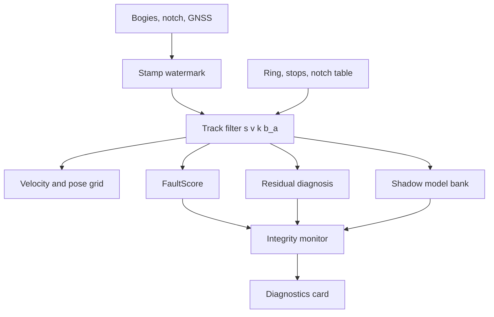

# Архитектура решения

Пакет `railbreak_backup_odometry`. Вокруг одного вероятностного фильтра работают слои диагностики; каждый из них читает уже посчитанные величины и пишет в `/result/diagnostics`, а публикуемые скорость и положение берутся из фильтра.

| Слой | Файл | Роль |
|---|---|---|
| Очередь входов | `input_reorder.hpp`, `source_quality.hpp`, `extrap_stamp.hpp` | Порядок по штампам, свежесть, контроль входа |
| Основной оцениватель | `track_odometer.hpp` | Фильтр Шмидта — Калмана `[s, v, k, bₐ]`, якоря, `notch_fault` |
| Выход | `velocity_output.hpp` | Сетка 0.04 с для скорости и сохранённой дуги |
| FaultScore | `fault_score.hpp` | Сглаженный счётчик отказа по каждой тележке |
| Диагноз невязки | `slip_hypothesis.hpp`, `adhesion_proxy.hpp` | Метки невязки и карточка `adhesion_proxy` |
| Банк моделей | `model_bank.hpp` | Пять фиксированных гипотез привода |
| Монитор целостности | `integrity_monitor.hpp`, `integrity_bound.hpp`, `interval.hpp` | Статусы, доверие по каналам, граница вдоль пути, `advisory_class` |
| Проверка непрерывности | `map_match.hpp` | Ближайший участок оси в окне шага, `junction` |

## Основной оцениватель

В коде массив из восьми чисел `x = [s, v, k, bₐ, k_front, k_rear, b_front, b_rear]`. Вероятностный блок, входящий в якобиан и в `S`, — `[s, v, k, bₐ]`: дуга вдоль маршрута, продольная скорость, общий масштаб колёс относительно карты и смещение модели ускорения. Четыре последних числа — диагностические параметры тележек: `k_front` и `k_rear` хранят отношение задней тележки к передней, поделённое пополам (их произведение равно 1, общий уровень остаётся у `k`), `b_front = b_rear = 0`.

Модель движения:

ṡ = v,  v̇ = a_tab(n, v) − g·i(s) + bₐ − (A + Bv + Cv²).

В поставке `A = B = C = 0` и `load_factor = 1`. Прогноз ограничивает `v` диапазоном `[0, v_max]`, `v_max = 30 м/с`. Якобиан прогноза содержит `Fₛᵥ = dt` и `F_(v,bₐ) = dt` вне стоянки.

Измерение колёс:

u_front = (1 + k_front)·v/k + b_front + e_front,  u_rear = (1 + k_rear)·v/k + b_rear + e_rear.

Перед сравнением `uᵢᶜ = (uᵢ − bᵢ)/(1 + kᵢ)` сравнивается с `v/k`; на колёсном шаге `Kₖ = 0`. Подробности — [model.md](model.md).

## FaultScore

На каждой тележке свой EWMA, `τ = 0.25 с`:

Fₜ = e^(−dt/τ)·F_(t−1) + (1 − e^(−dt/τ))·φ,

где `φ ∈ [0, 1]` читает NIS, расхождение тележек и невязку к модели. Вход в деградацию — счётчик канала выше 0.8 дольше 0.5 с; глубокий уровень — выше 0.95 дольше 2 с; снятие — ниже 0.2 дольше 3 с. Каждый канал считает свой таймер; защёлка общей моды требует подтверждения обоих каналов и считает пересечение их интервалов.

## Диагноз невязки

Ключ `slip` — порог невязки колеса к модели (`wheel_model_residual`). Метки слоя: `spin`, `slide`, `delay`, `single_bogie`, `sensor_fault`, `model_mismatch`. Кандидат после 0.15 с, подтверждение после 0.40 с, снятие после 1.0 с при невязке ниже выходного порога и согласии тележек. Вес измерения фильтр снижает сразу на большом NIS, метка на вес не влияет. Уровень `SLIP_SUSPECTED` зарезервирован под независимое подтверждение и сейчас не публикуется ([adhesion.md](adhesion.md)).

## Банк моделей

Пять фиксированных гипотез: `NOMINAL`, `ACTUATOR_DELAY` (ручка 0.30 с назад), `LOW_ADHESION` (ускорение зажато в ±0.40 м/с²), `WHEEL_SCALE` (масштаб 1.05), `MODEL_MISMATCH` (шум процесса × 20). У каждой — правдоподобие и вес, общий spread gate 8 м. Банк диагностирует несовпадение модели; основной оцениватель остаётся одномодельным, и публикуемая дуга берётся из него. Взвешивание по внутримодельным ковариациям не добавляет разброс между гипотезами, поэтому смесь в `P` не пишется. `fuse_modes` сравнивает абсолютные `s`, поэтому у шва кольца (`s = 0` и `s = L`) разность гипотез берётся только как диагностика.

## Монитор целостности

Статусы: `NOMINAL`, `DEGRADED_SINGLE_BOGIE`, `DEGRADED_MODEL_CARRY`, `DEGRADED_COMMON_MODE_UNOBSERVABLE`, `DEGRADED_NO_MAP`, `DEGRADED_RELATIVE_ONLY`, `POSITION_UNTRUSTED`, `LOST`. Отдельно публикуются `velocity_confidence`, `position_confidence`, доверие передней и задней тележки и `model_confidence` (`HIGH`, `LOW`, `NONE`).

Слепой бюджет общей моды: `max_blind_time_s = 5 с` и `max_blind_distance_m = 100 м` (путь от якоря — накопленная длина). После бюджета — `LOST`, доверие положения `NONE`, `/result/position` выходит с `σ = 1 км` и `integrity_use_position = false`; скорость может остаться с доверием `LOW`. Граница вдоль пути и её калибровка — [integrity.md](integrity.md).

Карточка `advisory_class` (`input_quality`, `common_mode`, `one_bogie_residual`, `both_residual`, `nominal`) — детерминированное правило поверх тех же признаков: плохой вход, невязка одной тележки и общая невязка получают разные метки.

## Порядок входов

Водяной знак строится по двум тележкам, без `/clock`:

t_watermark = min(t последних штампов тележек) − stamp_reorder_s, `stamp_reorder_s = 0`.

Ручка в минимум не входит: её штамп отстаёт, а ожидание ручки давало задержку выхода 53–305 мс. Опоздавшая ручка ставит положение рычага, если она новее уже принятой и отстаёт не больше чем на 0.5 с; позу со своим штампом она не публикует.

Поток, отстающий от самого свежего больше чем на 1.0 с, помечается `ORDER_NOT_RESTORED`. Пока он приходит, он остаётся в минимуме; из минимума он выходит после 50 чужих входов без своего. Пока отставание не больше 5.0 с, знак не уходит дальше чем на 1.0 с от его последнего штампа; большее отставание это ограничение снимает, чтобы остановившийся поток не держал выход до конца рейса. Сообщения выпускаются по штампу, при равном штампе — в порядке прихода. Штамп позади знака реального выхода в состояние не идёт и считается в `n_behind_out`. Поток, который ещё ни разу не говорил, в минимум не входит, поэтому поездку может начать один топик.

Таймер существует только в сборке без `DriverControllerCommand`: он повторяет последнюю скорость и водяной знак не двигает; вход, чей штамп уже покрыт повтором, повторно не публикуется (`skipped_behind_extrapolation`).
